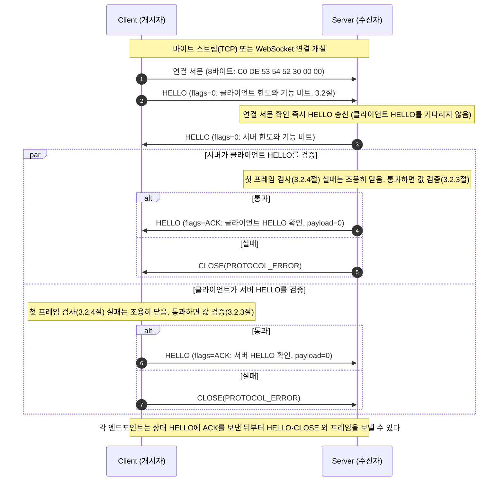
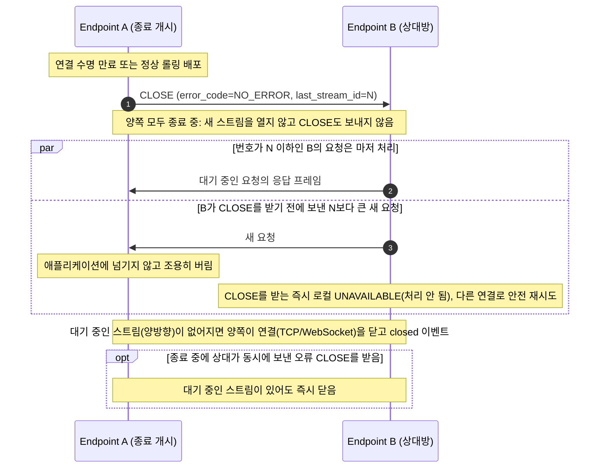
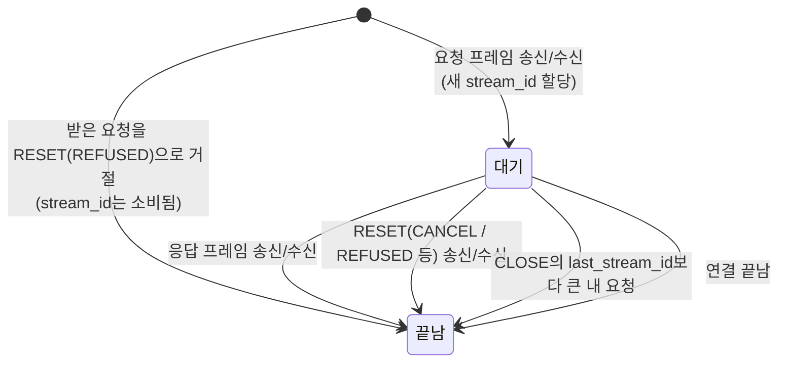

# Strand 규격

* **문서 상태 (Status)**: 초안 (Draft)
* **규격 버전 (Version)**: 0.2.0
* **호환성 (Compatibility)**: 0.1.0과 와이어 호환이 없다
* **작성일자 (Date)**: 2026-11-05
* **편집자 (Editor)**: 조정하 (@ppzxc)
* **저장소 (Repository)**: ppzxc/strand

---

## 1. 개요

Strand는 연결 하나로 여러 요청과 응답을 동시에 주고받기 위한 이진 메시지 프로토콜이다. 연결 안에서 요청 하나와 그 응답이 이루는 흐름을 가닥(strand)이라고 부르는데, 프로토콜 이름도 여기서 따왔다.

### 1.1 범위

이 문서는 연결을 맺는 절차, 프레임 형식, 제어 프레임, 파라미터 협상, 오류 처리, 배압, 그리고 연결을 유지하고 끝내는 방법을 다룬다. 반대로 메시지에 무엇을 담을지, 연결을 어떻게 보호할지(6절), 타이머를 몇 초로 둘지 같은 운영 문제는 다루지 않는다.

통신 방식은 한 가지뿐이다. 한 스트림에서 요청이 하나 가고 응답이 하나 돌아온다. 요청은 클라이언트뿐 아니라 서버도 먼저 보낼 수 있다.

분할, 압축 같은 기능은 이 문서에서 다루지 않는다.

### 1.2 공식 사용 환경

Strand 규격은 다음 두 가지를 동등한 공식 1급 사용 환경으로 정의한다.

1. **strand over TCP**:
   - 바이트 스트림 기반 사용 환경. 4바이트 `length` 필드를 읽어 프레임 경계를 구분한다.

2. **strand over WebSocket** [^RFC6455]:
   - 메시지 기반 사용 환경. 단일 WebSocket 바이너리 메시지(`Opcode 0x02`) 1개에 정확히 Strand 프레임 1개를 싣는다.
   - 프레임 헤더(20바이트)와 payload 형식, 제어 프레임 및 상태 머신은 strand over TCP와 100% 동일하다.
   - 연결 서문(Connection Preface)은 첫 번째 바이너리 메시지로 보내며(3.1절), 연결을 닫을 때(3.5절)는 WebSocket 닫기(`Close Frame 0x08`)를 수행한다. CLOSE를 보내는 종료에서는 CLOSE 송신 뒤에 수행하고, `NO_ERROR` 종료에는 `1000 Normal Closure`를 쓴다.
   - 메시지 경계 위반: 서문 메시지의 위반은 3.1절을 따른다. 서문 뒤에 텍스트 메시지가 오거나, 크기가 4 + `length`와 다른 바이너리 메시지가 오면 연결 오류다(MUST, 5.1절 3번).

### 1.3 용어

| 용어 (국문 / 영문) | 정의 |
| --- | --- |
| **엔드포인트 (Endpoint)** | 통신 연결의 한쪽 끝단. 물리적 연결을 주도하여 연 쪽을 **클라이언트 (Client)**, 연결을 수락한 쪽을 **서버 (Server)**로 정의 |
| **연결 (Connection)** | 연결 서문부터 연결이 끝날 때까지 하나의 전송 계층 연결 위에서 이어지는 통신 단위. 프로토콜의 모든 상태는 연결에 속하며 연결이 끝나면 사라진다 |
| **연결 서문 (Connection Preface)** | 클라이언트가 연결 수립 직후 단 1회 전송하는 8바이트 고정 식별자 (`C0 DE 53 54 52 30 00 00`) |
| **가닥 (Strand)** | 단일 연결 안에서 독립적으로 교환되는 하나의 요청과 그에 대한 단일 응답이 이루는 통신 단위 |
| **스트림 (Stream)** | 동일한 `stream_id`를 공유하는 요청 프레임과 응답 프레임의 논리적 쌍. 스트림당 1개 요청과 1개 응답만 허용 |
| **번호 공간 (Stream ID Space)** | 한 엔드포인트가 새 스트림에 쓰는 `stream_id`의 집합. 클라이언트는 홀수, 서버는 짝수를 쓰며, 크기 비교는 같은 공간 안에서만 한다(2.2.5절) |
| **대기 중인 스트림 (Pending Stream)** | 요청을 보냈거나 받아들였고, 아직 응답이나 RESET이 오가지 않은 스트림. 스트림의 상태는 대기와 끝남 두 가지뿐이다(4.3절) |
| **개시자 (Initiator)** | 특정 스트림의 요청 프레임을 먼저 전송하여 가닥(Strand)을 시작한 엔드포인트 (클라이언트 또는 서버) |
| **수신자 (Receiver)** | 개시자가 보낸 요청 프레임을 수신하여 처리하고 응답 프레임을 돌려주는 엔드포인트 |
| **프레임 (Frame)** | strand 전송의 기본 단위. 고정 20바이트 헤더, 가변 확장 영역, 가변 본문(payload)으로 구성 |
| **헤더 (Header)** | 모든 프레임 선두에 위치하는 20바이트 고정 크기 영역. 길이, 타입, 플래그, 스트림 번호, 상태 코드 등을 수록 |
| **제어 프레임 (Control Frame)** | 연결 수명주기, 생존 확인, 연결 종료, 스트림 중단 등 연결 상태를 관리하는 프레임 (`type` < `0x0100`) |
| **애플리케이션 프레임 (Application Frame)** | 실제 비즈니스 서비스의 요청 및 응답 데이터를 운반하는 프레임 (`type` ≥ `0x0100`) |
| **확장 영역 (Extension Area)** | 헤더와 본문 사이에 위치하는 선택적 메타데이터 영역. TLV(`tag`, `length`, `value`) 구조로 인코딩 |
| **본문 (Payload)** | 프레임에 실리는 실제 데이터 바이트열. 제어 프레임은 고정 바이너리 형식을, 애플리케이션 프레임은 Protocol Buffers 이진 인코딩을 따름 |
| **기능 비트 (Capabilities Bitset)** | HELLO 프레임에서 교환하는 32비트 비트셋. 양 엔드포인트가 모두 켠 비트의 기능만 해당 연결에서 활성화 |
| **배압 (Backpressure)** | 수신자의 처리 용량을 초과하지 않도록 송신량을 제어하는 메커니즘. 소켓 읽기를 멈추지 않고 한도를 넘는 새 요청이나 로컬 사유로 받지 않는 새 요청을 즉시 거절한다(4.5절) |
| **거절 (Refusal)** | 받는 쪽이 새 요청을 애플리케이션에 넘기기 전에 `RESET(REFUSED)`로 돌려보내는 것. 거절한 요청은 처리를 시작하지 않은 것이라 결과 확정성이 늘 처리 안 됨이다(4.4절, 4.5절) |
| **동시 스트림 수 (Concurrent Streams)** | 한 번호 공간에서 대기 중인 스트림의 개수. 받는 쪽은 상대 공간을, 보내는 쪽은 내 공간을 센다(3.2.3절, 4.5절) |
| **연결 종료 (CLOSE)** | 연결 전체의 종료를 알리는 제어 프레임. payload에 `error_code`와 `last_stream_id`를 싣는다(3.5절) |
| **연결 오류 (Connection Error)** | 5.1절 3번 목록에 드는 수신 입력과 그 반응(5.1절) |
| **CLOSE 교환 (Close Exchanged)** | CLOSE를 보냈거나 받은 상태(3.5절) |
| **종료 중인 연결 (Closing)** | `NO_ERROR` CLOSE를 보냈거나 받은 연결. 곧 `NO_ERROR`로 CLOSE 교환이 된 연결(3.5절) |
| **결과 확정성 (Outcome Certainty)** | 내가 보낸 요청마다 애플리케이션에 넘기는 로컬 결과에 `status`와 별도로 붙는 속성. 와이어에는 싣지 않는다. **응답 받음**은 상대의 응답을 받아 결과가 정해진 것이다. **처리 안 됨**은 상대가 요청 처리를 시작하지 않았음이 확실한 것이다. **결과 모름**은 상대가 요청을 처리했는지 알 수 없는 것이다. 사건별 값은 2.2.5절, 3.2.3절, 3.5절, 4.1절, 4.4절이 정한다 |
| **요청 기한 (Request Deadline)** | 요청한 쪽이 요청마다 로컬에서 두는 시간 제한. 기한이 지나면 요청을 포기한다(4.4.1절) |
| **과도한 사용 (Excessive Use)** | 상대가 연결을 지나치게 써서 더는 받아 줄 수 없는 상태(2.5.2절의 `EXCESSIVE_USE`) |
| **확인 대기 (Ack Wait)** | HELLO나 PING을 전송 계층에 넘긴 뒤 상대의 ACK를 기다리는 구간(3.3절) |
| **연결이 끝남 (Connection End)** | 전송 계층이 닫혀 더는 아무것도 주고받지 않게 된 때. 원인이 CLOSE 교환이든 연결 오류든 상대의 전송 계층 끊김이든 같고, 이때 `closed` 이벤트를 낸다(3.5절) |

### 1.4 표기 규칙

- 연결 서문, 프레임 헤더, 확장 영역, 제어 프레임 payload에 들어가는 고정 길이 정수는 모두 big-endian, unsigned로 읽는다. 애플리케이션 payload는 Protocol Buffers 이진 인코딩 규칙을 따른다 [^PROTOBUF-ENCODING].
- 필드와 파라미터 이름은 `snake_case`, 프레임 타입·플래그·코드 상수는 `UPPER_SNAKE_CASE`로 쓴다.
- MUST, MUST NOT, SHOULD, SHOULD NOT, MAY는 대문자로 쓴 경우에만 요구 수준을 뜻한다 [^RFC2119] [^RFC8174].
- `0x`가 붙은 수는 16진수이고, KiB·MiB는 1,024의 배수다.

---

## 2. 프레임 기초

### 2.1 기본 프레임 구조

프레임은 20바이트 고정 헤더 뒤에 확장 영역과 본문(payload)이 차례로 붙는 구조다.

```
 0                   1                   2                   3
 0 1 2 3 4 5 6 7 8 9 0 1 2 3 4 5 6 7 8 9 0 1 2 3 4 5 6 7 8 9 0 1
+---------------------------------------------------------------+
|                            length                             |  0
+-------------------------------+---------------+---------------+
|             type              |     flags     |    status     |  4
+-+-------------------------------------------------------------+
|0|                                                             |  8
+-+                          stream_id                          +
|                                                               | 12
+-------------------------------+-------------------------------+
|       extensions_length       |           reserved            | 16
+-------------------------------+-------------------------------+
|              extensions (extensions_length 바이트)          ...  20
+---------------------------------------------------------------+
|              payload (나머지)                               ...
+---------------------------------------------------------------+
```

| 위치 | 크기 | 필드 |
| --- | --- | --- |
| 0 | 4 | `length` |
| 4 | 2 | `type` |
| 6 | 1 | `flags` |
| 7 | 1 | `status` |
| 8 | 8 | `stream_id` (최상위 비트는 항상 0) |
| 16 | 2 | `extensions_length` |
| 18 | 2 | `reserved` |
| 20 | 가변 | `extensions` |
| 20 + `extensions_length` | 가변 | `payload` |

프레임 전체 크기는 4 + `length`이고, payload 크기는 `length`에서 16과 `extensions_length`를 뺀 값이다. 확장 영역과 본문이 모두 비면 20바이트가 되는데, 이것이 가장 작은 프레임이다. 이 버전에서는 프레임 하나가 곧 메시지 하나다.

### 2.2 헤더 필드

#### 2.2.1 length (4바이트)

이 필드 바로 뒤부터 프레임 끝까지의 바이트 수다. 최솟값은 16이고, 최댓값은 받는 쪽이 알린 `max_frame_size`에서 4를 뺀 값이다. 받는 쪽은 언제나 자기가 알린 `max_frame_size`로 검사한다. 범위를 벗어난 프레임은 연결 오류다(MUST, 5.1절).

#### 2.2.2 type (2바이트)

프레임 종류를 나타낸다. `0x0000`부터 `0x00FF`까지는 제어 프레임(3절 및 4절), `0x0100`부터 `0xFFFF`까지는 애플리케이션 프레임에 쓴다(4.1절). 응답 프레임에는 요청과 같은 `type` 값을 넣는다(MUST). 제어 프레임 타입 중 `0x0000`과 `0x0005`\~`0x00FF`는 예약된 타입이며, 받으면 무시한다(MUST, 5.1절). 이때 `stream_id`는 검사하지 않는다. 다만 상대에게서 처음 받는 프레임이면 첫 프레임 검사(3.2.4절)가 먼저다.

#### 2.2.3 flags (1바이트)

2.3절에서 따로 설명한다.

#### 2.2.4 status (1바이트)

애플리케이션 요청을 처리한 결과다. 값의 의미는 2.5.1절에 있다. 이 필드는 애플리케이션 응답에서만 의미가 있으므로, 그 밖의 프레임에서는 0으로 보내고 받는 쪽은 값을 보지 않는다(MUST).

#### 2.2.5 stream\_id (8바이트)

클라이언트가 여는 스트림은 홀수, 서버가 여는 스트림은 짝수 `stream_id`를 쓴다. 이 두 구간이 번호 공간이다(1.3절). `stream_id`의 범위는 `1`\~`2^63-1`이며 최상위 비트는 항상 0이다.

0번은 연결 전체를 다루는 제어 프레임 전용이다. HELLO·PING·CLOSE의 `stream_id`는 정확히 `0x0000000000000000`이어야 한다(MUST). 위반하면 연결 오류다(MUST, 5.1절).

애플리케이션 프레임이나 RESET의 `stream_id`가 0이거나 최상위 비트가 1이면 연결 오류다(MUST, 5.1절).

새 스트림을 열 때는 자기 번호 공간에서 매번 이전보다 큰 `stream_id`를 쓴다(MUST). 첫 번호는 클라이언트가 1, 서버가 2다. 건너뛰는 것은 허용하며, 건너뛴 번호는 영원히 쓰이지 않는다. 같은 공간 안에서는 `stream_id`를 정수로 바로 비교한다.

엔드포인트는 상대 공간의 `highest_peer_stream_id`를 유지한다.
* `highest_peer_stream_id`: 지금까지 새 요청으로 인정한 가장 큰 `stream_id`(처음에는 0). 갱신 시점은 5.1절이 정한다.

**번호 소진.** 내 공간에서 다음에 쓸 번호가 `2^63-1`을 넘으면, 그 요청은 프레임을 보내지 않고 애플리케이션에 로컬 `UNAVAILABLE`로 실패시킨다(MUST). 이 실패는 스트림을 열기 전의 로컬 결과라서 `stream_id`가 없고, 결과 확정성은 처리 안 됨이다. 엔드포인트는 `CLOSE(NO_ERROR)`를 보낸다(MUST). 이미 CLOSE를 보냈거나 받았다면 3.5절에 따라 보내지 않는다.

`stream_id`는 같은 연결 안에서만 유일하다. 연결이 바뀌어도 같은 요청임을 알아봐야 할 때는 `idempotency-key` 확장(2.4절)을 쓴다.

#### 2.2.6 extensions\_length (2바이트)

확장 영역의 바이트 수다. 0이면 확장 영역이 없다는 뜻이다. `extensions_length`가 `length` − 16이나 8,192를 넘으면 오류로 처리한다. 이 오류는 2.4.1절의 형식 위반과 같이 연결 오류다(MUST, 5.1절).

#### 2.2.7 reserved (2바이트)

항상 0으로 보내고, 받은 값은 무시한다(MUST).

### 2.3 플래그

플래그의 뜻은 프레임 `type`마다 다르다.

| `type` | `0x01` |
| --- | --- |
| HELLO, PING | `ACK` |
| CLOSE, RESET | — |
| 애플리케이션 (`type` ≥ `0x0100`) | — |

* `ACK`: HELLO·PING에 대한 확인이다.

규칙은 하나다. 해당 `type`에 의미가 정의되지 않은 비트(표의 —)와 `0x02`\~`0x80`은 0으로 보내고(MUST), 받으면 무시한다(MUST). 애플리케이션 프레임의 `flags`는 모든 비트가 미정의다. 요청과 응답은 `flags`가 아니라 번호 공간으로 구분한다(4.2절). 따라서 CLOSE·RESET·애플리케이션 프레임에 어떤 비트가 켜져 와도 오류로 처리하지 않으며, 이들의 `flags`를 따로 검사하는 단계는 없다.

연결 첫 프레임은 `flags == 0`이어야 한다(3.2.4절).

### 2.4 확장 영역

확장 영역은 요청에 덧붙이는 부가 정보를 담는 곳이다. 항목마다 자기 길이를 들고 있어서, 받는 쪽은 모르는 항목을 그냥 건너뛰면 된다.

#### 2.4.1 항목 형식

```
+-------------------------------+-------------------------------+
|              tag              |            length             |
+-------------------------------+-------------------------------+
|                     value (length 바이트)                  ...
+---------------------------------------------------------------+
```

항목 사이에는 패딩이 없다. 각 항목의 (4 + `length`)를 모두 더한 값은 `extensions_length`와 정확히 같아야 한다(MUST). 한 프레임에 같은 `tag`를 두 번 쓸 수 없다. 이를 어기면 확장 영역 형식 위반이며 연결 오류다(MUST, 5.1절). `tag` 공간 전체(`0x0000`\~`0xFFFF`)가 같은 규칙을 따르며, 2.4.2절에 정의된 항목만 해석하고 모르는 `tag`는 모두 건너뛴다(MUST).

> 비규범 주석: 받는 쪽이 반드시 이해해야 하는 기능은 확장 영역 항목으로 만들지 않고, 기능 비트(3.2절)로 먼저 합의한 연결에서만 쓴다.

#### 2.4.2 정의된 항목

| tag | 이름 | 값 | 의미 |
| --- | --- | --- | --- |
| `0x0001` | `timeout` | u32, 밀리초 | 요청을 처리할 수 있는 시간. 받는 쪽에 주는 힌트다 |
| `0x0002` | `traceparent` | 바이트열 | 분산 추적 문맥 [^W3C-TRACE-CONTEXT]. 프로토콜은 값을 검사하지 않는다 |
| `0x0003` | `idempotency-key` | 바이트열, 1\~64바이트 | 같은 요청의 재전송을 식별하는 키 |

`timeout`은 요청을 받은 시점부터 센다. 0은 특수값이 아니며 받은 시점에 이미 만료된 것이다. 시간이 다 되면 받는 쪽은 처리를 멈추고 `DEADLINE_EXCEEDED`로 응답하는 것이 좋다(SHOULD).

요청의 `timeout` 길이가 4가 아니거나 `idempotency-key` 길이가 1\~64를 벗어나면 연결은 그대로 두고 `status` = `INVALID_ARGUMENT`로 답한다(MUST).

정의된 항목은 요청에서만 의미가 있다. 응답의 확장 영역은 형식만 검사하고(2.4.1절) 내용은 무시한다(MUST).

#### 2.4.3 제어 프레임의 확장 영역

제어 프레임(`type` < `0x0100`, 예약 타입 포함)은 `extensions_length`가 0이어야 한다(MUST). 아니면 연결 오류이며(MUST, 5.1절), 제어 프레임의 확장 영역은 파싱하지 않는다.

### 2.5 코드 체계

코드는 두 종류다. 요청을 처리한 결과는 응답 헤더의 `status`에 담고, 연결이나 스트림을 끊는 이유는 CLOSE·RESET의 `error_code`에 담는다.

#### 2.5.1 status (애플리케이션 결과)

`status`는 gRPC의 상태 코드 번호를 그대로 쓴다 [^GOOGLE-RPC].

| 값 | 이름 | 쓰임새 |
| --- | --- | --- |
| 0 | `OK` | 성공 |
| 1 | `CANCELLED` | 취소됨 |
| 2 | `UNKNOWN` | 분류되지 않는 오류 |
| 3 | `INVALID_ARGUMENT` | 요청 값이 잘못됨 |
| 4 | `DEADLINE_EXCEEDED` | 기한을 넘김 |
| 5 | `NOT_FOUND` | 대상이 없음 |
| 6 | `ALREADY_EXISTS` | 이미 존재함 |
| 7 | `PERMISSION_DENIED` | 신원은 확인됐으나 권한이 없음 |
| 8 | `RESOURCE_EXHAUSTED` | 한도·할당량 초과 |
| 9 | `FAILED_PRECONDITION` | 현재 상태에서는 수행할 수 없음 |
| 10 | `ABORTED` | 동시 작업과 충돌 |
| 11 | `OUT_OF_RANGE` | 범위를 벗어난 값 |
| 12 | `UNIMPLEMENTED` | 구현되지 않았거나 지원하지 않음 |
| 13 | `INTERNAL` | 내부 오류 |
| 14 | `UNAVAILABLE` | 일시적으로 처리할 수 없음 |
| 15 | `DATA_LOSS` | 복구할 수 없는 데이터 손실 |
| 16 | `UNAUTHENTICATED` | 신원을 확인할 수 없음 |
| 17\~255 | 예약 | 받으면 `UNKNOWN`으로 취급 |

`status`가 `OK`가 아닌 응답의 payload는 비우거나 애플리케이션이 정한 내용을 넣는다. 프로토콜은 이 payload를 해석하지 않는다.

#### 2.5.2 error\_code (연결/스트림 중단 사유)

| 값 | 이름 | 쓰임새 |
| --- | --- | --- |
| 0 | `NO_ERROR` | 오류 없음 |
| 1 | `PROTOCOL_ERROR` | 이 문서의 규칙 위반. 크기 위반 포함 |
| 2 | `INTERNAL_ERROR` | 엔드포인트 내부 오류 |
| 3 | `REFUSED` | 처리를 시작하지 않고 거절함. 다시 보내도 안전 |
| 4 | `CANCEL` | 스트림을 더 이상 처리하지 않음 |
| 5 | `EXCESSIVE_USE` | 상대의 과도한 사용. CLOSE 전용 |
| 6 | `UNRESPONSIVE` | 상대가 확인 대기 안에 ACK를 보내지 않음. CLOSE 전용 |
| 7 | `UNAUTHENTICATED` | 자격 증명을 거부하거나 폐기함. 다시 시도해도 소용없음. CLOSE 전용 |
| 8\~ | 예약 | 받으면 `INTERNAL_ERROR`로 취급 |

---

## 3. 연결 수명주기

Strand는 두 엔드포인트 사이에 순서가 보장되는 양방향 전송 채널이 열린 뒤부터 시작한다. 채널을 보호하는 방법은 6절을 참고한다.

### 3.1 연결 서문 (Connection Preface)

연결이 열리면 클라이언트는 무엇보다 먼저 아래 8바이트 연결 서문(Connection Preface)을 보낸다(MUST). strand over WebSocket에서는 이를 첫 번째 바이너리 메시지로 보낸다.

```
C0 DE 53 54 52 30 00 00
└─┬─┘ └────┬────┘ └─┬─┘
 식별값  "STR0"     예약(0)
```

서버는 앞 6바이트가 이 값과 다르면 아무 응답 없이 연결을 끊는다(MUST). strand over WebSocket에서 서문 메시지가 바이너리 메시지가 아니거나 정확히 8바이트가 아닌 경우도 같다(MUST). 마지막 2바이트는 예약 영역이라 0으로 보내고, 받는 쪽에서는 보지 않는다.

`"STR0"`의 `0`이 이 프로토콜의 메이저 버전이다. 버전 번호는 여기 한 곳에만 있고, 값이 다르면 서로 통신할 수 없다. 같은 버전 안에서 기능을 늘릴 때는 버전을 올리는 대신 기능 비트(3.2절)를 쓴다.

서버는 연결 서문을 보내지 않는다. 서버가 보내는 첫 프레임은 HELLO다(3.2절).

### 3.2 HELLO 및 파라미터 협상

HELLO는 연결마다 한 번, 내가 받을 수 있는 한도와 지원하는 기능을 상대에게 알리는 프레임이다. 제어 프레임의 payload는 고정된 바이너리 형식이다.

* **type**: `0x0001`
* **stream_id**: `0`
* **payload**: `(identifier u16, value u32)`의 반복. 확인은 `ACK` 플래그 + 빈 payload (길이 0).

한 연결에서 HELLO 프레임은 엔드포인트마다 파라미터 HELLO(`flags = 0`) 하나와 상대 HELLO를 확인하는 ACK HELLO(`flags = ACK`) 하나다.

#### 3.2.1 파라미터 정의

| identifier | 이름 | 기본값 | 보내는 쪽 | 의미 |
| --- | --- | --- | --- | --- |
| `0x0001` | `max_frame_size` | 4,194,304 (4 MiB) | 양쪽 | 받을 수 있는 프레임의 최대 크기. 곧 메시지 최대 크기. 허용 범위 16 KiB\~16 MiB(벗어나면 3.2.3절) |
| `0x0002` | `max_concurrent_streams` | 100 | 양쪽 | 상대가 동시에 열 수 있는 스트림 수. 범위 `0`\~`2^32-1` |
| `0x0003` | `capabilities` | 0 | 양쪽 | 기능 비트셋. 이 버전에서는 모든 비트가 예약 |

#### 3.2.2 HELLO 송신

HELLO 송신 규칙은 다음과 같다(모두 MUST).

1. **독립 프레임**: 엔드포인트는 파라미터 `HELLO(flags=0)`와 확인용 `HELLO(flags=ACK, payload 길이 0)`를 서로 다른 두 프레임으로 보낸다. 둘을 합친 프레임(ACK이면서 payload가 비어 있지 않은 HELLO)은 허용하지 않으며, 받으면 3.2.5절의 연결 오류다.
2. **순서**: 파라미터 HELLO가 먼저이고 상대 HELLO에 대한 ACK HELLO가 나중이다.
3. **송신 시점**: 서버는 연결 서문을 확인한 즉시(3.1절) 자기 파라미터 HELLO를 보낸다. 클라이언트 HELLO를 기다리지 않는다.

#### 3.2.3 협상 규칙

모르는 identifier는 무시한다(MUST). 같은 identifier가 두 번 나오는 것은 모르는 identifier라도 연결 오류다(3.2.5절).

`max_*` 값은 보낸 쪽이 받아들일 수 있는 한도다. 그러니 각 엔드포인트는 상대가 알린 `max_frame_size`보다 큰 프레임을 보내지 않고(MUST), 내가 연 스트림 중 대기 중인 것(4.3절)이 이미 상대가 알린 `max_concurrent_streams`개이면 새 요청을 보내지 않는다(MUST). 받는 쪽이 세는 방법과 거절은 4.5절이다. 한도에 닿았을 때 새 요청을 기다리게 할지 로컬에서 실패시킬지는 구현이 정한다. 실패시키면 프레임을 보내지 않고 번호도 쓰지 않으며, 결과는 `stream_id` 없는 로컬 `UNAVAILABLE`(처리 안 됨)이다. 상대 HELLO를 받기 전에 보내는 프레임(HELLO·CLOSE)은 상대의 `max_frame_size`를 허용 범위의 최솟값 16 KiB로 보고 보낸다(MUST). 상대 HELLO가 연결 오류에 걸려 보내는 CLOSE도 같다.

각 엔드포인트는 상대 HELLO가 첫 프레임 검사(3.2.4절)를 통과하면 payload를 검증한다(MUST). `max_frame_size`가 허용 범위(16 KiB\~16 MiB) 밖이면 검증에 실패한 것이며 연결 오류다(5.1절). 통과하면 상대 HELLO에 ACK HELLO로 답하고, 실패하면 ACK를 보내지 않는다. 서버와 클라이언트가 같은 규칙을 쓴다.

연결에서 실제로 쓸 수 있는 기능은 양쪽 `capabilities`에 공통으로 켜진 비트뿐이다.

HELLO는 연결 도중에 다시 보내지 않는다. 값을 바꾸고 싶으면 새 연결을 맺는다.

#### 3.2.4 첫 프레임 검사

각 엔드포인트는 상대에게서 처음 받는 프레임(첫 프레임)의 헤더만 읽은 상태에서, payload를 읽기 전에 아래를 확인한다(MUST). 하나라도 어긋나면 아무것도 보내지 않고 연결을 닫는다. 서버에게 첫 프레임은 연결 서문 다음에 오는 프레임이고, 클라이언트에게는 서버가 보낸 첫 프레임이다. 서버는 연결 서문을 확인한 즉시 HELLO를 보내므로(3.2.2절), 첫 프레임 검사에 실패해 닫을 때 이미 보낸 HELLO가 있을 수 있다.

1. `type`이 `0x0001`(HELLO)인가
2. `stream_id`와 `flags`가 모두 0인가

첫 프레임의 헤더를 읽을 수 없으면(`length`가 16 미만이거나, WebSocket 첫 프레임 메시지가 텍스트이거나 20바이트보다 짧음) 위 검사에 실패한 것으로 본다.

#### 3.2.5 HELLO 형태 위반

첫 프레임 검사를 통과한 뒤에도 HELLO 형태가 어긋나면 연결 오류다(MUST, 5.1절).

* 파라미터 HELLO의 payload 길이가 6의 배수가 아님
* ACK HELLO의 payload가 비어 있지 않음(3.2.2절의 합친 프레임)
* 파라미터 HELLO를 두 번째로 받음
* 내가 보낸 HELLO에 대한 ACK를 두 번째로 받음
* 파라미터 HELLO에 같은 identifier가 두 번 나옴(모르는 identifier도 포함). 확장 영역의 중복 tag 금지(2.4.1절)와 같은 규칙이다

### 3.3 수립 순서

1. 클라이언트는 연결 서문을 보내고 곧바로 파라미터 HELLO를 이어 보낸다(MUST).
2. 서버는 연결 서문을 3.1절 기준으로 확인한 즉시 자기 파라미터 HELLO를 보낸다(3.2.2절).
3. 양쪽은 상대 HELLO를 받으면 3.2.4절 첫 프레임 검사를 한다. 실패하면 조용히 닫는다. 통과하면 3.2.3절 검증을 하고, 통과하면 ACK HELLO로 답하며 실패하면 연결 오류다(3.2.3절).

**송신 규칙.** HELLO·CLOSE 외 모든 프레임은 상대 HELLO에 ACK를 보낸 뒤에만 보낸다(MUST). 서버는 클라이언트 HELLO에 ACK를 보낸 직후부터 보낼 수 있고 클라이언트의 ACK를 기다리지 않는다. 클라이언트는 서버 HELLO를 검증하고 ACK를 보낸 뒤부터 보낼 수 있다. "수립 완료" 같은 별도 상태는 없다.

**수신 규칙(ACK 관문).** 내가 보낸 HELLO에 대한 상대의 ACK를 받기 전에는 HELLO와 CLOSE만 받는다. 그 전에 PING·RESET·애플리케이션 프레임이 오면 연결 오류다(MUST, 5.1절). 예약 제어 타입은 ACK 전에도 무시한다(2.2.2절).

**확인 대기.** HELLO나 PING을 전송 계층에 넘긴 때(WebSocket에서는 그 프레임을 담은 바이너리 메시지를 WebSocket 계층에 넘긴 때)부터 정해 둔 시간이 지나도록 상대의 ACK가 오지 않으면 `CLOSE(UNRESPONSIVE)`를 보내고 닫는다(MUST). 이미 CLOSE를 보냈거나 받았다면 보내지 않는다(3.5절). 대기 시간의 값은 로컬 설정이다.



### 3.4 생존 확인: PING

PING은 어느 쪽이든 보낼 수 있다.
* **type**: `0x0002`
* **stream_id**: `0`
* **payload**: 정확히 8바이트 (임의의 바이트열)

`ACK` 플래그가 없는 PING을 받은 쪽은 같은 8바이트에 `ACK` 플래그(`flags = 0x01`)를 붙여 즉시 돌려준다(MUST). ACK PING에는 답하지 않는다(MUST NOT). 보낸 PING과 맞춰 보는 일은 로컬 몫이므로, 보낸 PING과 맞지 않는 ACK PING도 무시한다. payload 길이가 정확히 8바이트가 아니면 ACK PING이든 아니든 연결 오류다(5.1절). ACK를 기다리는 시간의 한도는 3.3절의 확인 대기 규칙을 따른다.

> 비규범 주석: 확인 대기 시간은 상대의 `max_frame_size` 크기 프레임 하나를 보내는 데 걸리는 시간보다 길게 잡는다. 그보다 짧으면 큰 프레임을 주고받는 중인 정상 연결을 끊는다.

#### 3.4.1 유휴 시 PING

엔드포인트는 유휴 간격 동안 상대에게서 받은 프레임이 없으면 PING을 보낸다(SHOULD). 보내는 때는 3.3절의 송신 규칙을 따른다. 유휴 간격의 값은 로컬 설정이다.

### 3.5 연결 종료: CLOSE

CLOSE는 연결 전체의 종료를 알리는 프레임이다.
* **type**: `0x0003`
* **stream_id**: `0`
* **payload**: `error_code` u32 (4B) + `last_stream_id` u64 (8B) + `reason` 가변 (UTF-8 문자열, 0B 이상)

```
CLOSE payload
+-----------------------------+
|        error_code (32)      |
+-----------------------------+
|                             |
|      last_stream_id (64)    |
|                             |
+-----------------------------+
|      reason (가변, UTF-8) ...
+-----------------------------+
```

`last_stream_id`는 CLOSE를 보내는 순간의 `highest_peer_stream_id`(2.2.5절)와 같아야 한다(MUST). 상대가 보낸 요청이 아직 없으면 0이다.

`reason`은 사람이 읽으라고 넣는 설명이다. 받는 쪽은 `reason`의 UTF-8 유효성을 포함해 내용을 검증하지 않으며, 프로그램 동작이 이 값에 기대서는 안 된다.

**형태가 잘못된 CLOSE.** 다음 중 하나에 해당하는 CLOSE다. 5.1절 3번이 연결 오류로 처리한다.
* payload가 12바이트 미만이다.
* `last_stream_id`가 0이 아니면서 내 번호 공간의 값이 아니다.
* `last_stream_id`가 내가 요청 프레임을 보낸 스트림 가운데 가장 큰 `stream_id`보다 크다. 요청 프레임을 보내지 못한 번호는 세지 않으며, 보낸 요청이 없으면 0보다 큰 모든 값이 해당한다.

**받은 CLOSE.** `type`이 CLOSE인 프레임은 형태가 잘못돼도 받은 CLOSE로 치고, 형태가 잘못된 CLOSE는 오류 CLOSE처럼 다룬다. 예외는 없다. 따라서 형태가 잘못된 CLOSE를 받으면 CLOSE를 보내지 않고 즉시 닫는다. 이 CLOSE의 `last_stream_id`는 쓰지 않으므로, 대기 중인 내 요청은 아래 "연결이 끝날 때"의 규칙을 따른다.

CLOSE를 받으면 그 즉시, 대기 중인 내 요청 가운데 `stream_id`가 그 CLOSE의 `last_stream_id`보다 큰 것마다 애플리케이션에 로컬 `status` = `UNAVAILABLE`(처리 안 됨) 결과를 정확히 한 번 넘기고 그 스트림을 끝낸다(MUST). CLOSE를 둘 이상 받으면 처음 받은 CLOSE의 `last_stream_id`만 쓴다(MUST).

엔드포인트는 CLOSE를 보내거나 받기 전이라면 로컬 판단으로 언제든 CLOSE를 보낼 수 있다(MAY). 과도한 사용 때문이면 `EXCESSIVE_USE`, 그 밖에는 `NO_ERROR`를 쓴다. CLOSE를 보냈거나 받은 뒤에는 CLOSE를 보내지 않고(MUST NOT) 새 스트림도 열지 않는다(MUST). 그 뒤에 보내야 할 오류 CLOSE(5.1절의 연결 오류, 확인 대기 초과)도 보내지 않고 전송 계층만 닫는다. 상대는 이를 CLOSE 없이 끊긴 것으로 처리한다. 양쪽이 동시에 CLOSE를 보내 엇갈리는 것은 허용한다.

CLOSE를 보냈거나 받은 뒤 애플리케이션이 새 요청을 내면 프레임을 보내지 않고 애플리케이션에 로컬 `UNAVAILABLE`(처리 안 됨)로 실패시킨다(MUST). 이 실패는 스트림을 열기 전의 로컬 결과라서 `stream_id`가 없다. CLOSE를 보냈거나 받은 뒤 상대가 보낸 새 요청은 끝까지 읽고 애플리케이션에 넘기지 않은 채 조용히 버린다(MUST). 그 요청에 대해서는 어떤 프레임도 보내지 않는다. 번호 역행 같은 연결 오류 검사는 이 요청에도 그대로 적용한다(5.1절). 상대는 내가 보낸 `last_stream_id`로 그 요청이 처리되지 않았음을 안다.

닫는 시점은 `error_code`가 정한다. 대기 중인 스트림은 내가 연 것과 상대가 연 것을 모두 센다(4.3절).

* 오류 CLOSE(`NO_ERROR`가 아닌 코드)를 보냈거나 받았으면 즉시 전송 계층을 닫는다(MUST). 대기 중인 스트림이 남아 있어도 기다리지 않는다. 연결이 종료 중일 때 받은 오류 CLOSE도 같다.
* 그 밖에 `NO_ERROR` CLOSE를 보냈거나 받았으면 연결은 **종료 중**이 된다. 대기 중인 스트림이 없어지면(처음부터 없는 경우 포함) 전송 계층을 닫는다(MUST). 종료 중 상태 자체에는 시간 제한을 두지 않으며 얼마나 기다릴지는 애플리케이션이 정한다. 종료 중에도 생존 확인(3.3절의 확인 대기, 3.4.1절의 유휴 시 PING)은 계속한다.

**연결이 끝날 때.** CLOSE를 보내거나 받아 닫을 때, CLOSE 없이 닫을 때(5.1절 1번·2번, 이미 CLOSE를 보냈거나 받은 뒤의 연결 오류와 확인 대기 초과 포함), 상대가 CLOSE 없이 전송 계층을 끊었을 때(TCP EOF·RST, WebSocket close) 모두 연결이 끝난 것이다. 전송 계층이 끊기면 보낼 수 없으므로 아무것도 보내지 않는다. 연결이 끝날 때 응답도 RESET도 받지 못한 채 대기 중인 내 요청(CLOSE의 `last_stream_id`로 이미 끝난 요청은 대기 중이 아니다. 상대 한도에 걸려 스트림을 열기 전에 대기열에서 기다리는 요청 포함)마다 애플리케이션에 로컬 `status` = `UNAVAILABLE` 결과를 정확히 한 번 넘기고(MUST), 그 뒤에 `closed` 이벤트를 낸다. 결과 확정성은 요청의 마지막 바이트를 전송 계층에 넘겼는지로 정한다(WebSocket에서는 그 프레임을 담은 바이너리 메시지를 WebSocket 계층에 넘겼는지). 넘기기 전이면 처리 안 됨이고, 넘긴 뒤이면 결과 모름이다. `closed`는 연결당 정확히 한 번 낸다. 이미 닫힌 뒤에 전송 계층 끊김이 감지되어도 `closed`를 다시 내지 않고 아무것도 보내지 않는다. `NO_ERROR`로 마저 끝내고 대기 중인 스트림이 없어져 닫을 때도 `closed`는 마지막 스트림의 result(정상 응답 포함) 다음에 낸다(MUST). 이 `status`는 상대가 보낸 것이 아니라 로컬에서 만든 결과다. 상대가 연 스트림은 내 요청이 아니므로 결과를 넘기지 않는다. 다시 보내도 되는지는 결과 확정성에 따라 4.6절이 정한다.



#### 3.5.1 끊기 전에 돌려보내기

전송 계층을 닫기 전에, CLOSE를 보내거나 받기 전에 받아들인 상대의 요청 가운데 아직 애플리케이션에 넘기지 않은 것은 `RESET(REFUSED)`로 돌려보내는 것이 좋다(SHOULD). CLOSE를 보내거나 받은 뒤에 온 새 요청은 3.5절에 따라 버리므로 해당하지 않는다. 종료 중에 더 기다리지 않고 닫기로 했을 때와 오류 CLOSE를 보낼 때가 해당하며, 오류 CLOSE를 보낼 때는 CLOSE보다 먼저 보낸다. 돌려보낸 요청의 스트림은 RESET을 보내는 즉시 끝나고(4.3절), 상대는 그 요청을 처리 안 됨(4.4절)으로 확정한다. 돌려보내지 않은 요청은 상대에게 결과 모름으로 남는다.

---

## 4. 스트림 및 애플리케이션 통신

### 4.1 애플리케이션 프레임

애플리케이션 프레임의 `type`은 `0x0100` 이상의 값으로, 서비스 정의(`.proto`)의 메서드마다 하나씩 붙인다. payload에는 Protocol Buffers 이진 인코딩 [^PROTOBUF-ENCODING]으로 만든 요청이나 응답 메시지가 들어간다.

모르는 `type`으로 요청이 오면 연결은 그대로 두고 `status` = `UNIMPLEMENTED`로 답한다(MUST). 메시지 형식을 호환되지 않게 바꿔야 할 때는 기존 `type`을 고치지 말고 새 번호를 받는다.

프로토콜은 애플리케이션 payload를 해석하지 않고 그대로 넘긴다. 애플리케이션은 요청 payload를 해석하지 못하면 `status` = `INVALID_ARGUMENT`로 답하는 것이 좋다(SHOULD).

**응답 해석.** 응답의 `type`이 요청과 다르면(2.2.2절) 애플리케이션에 로컬 `status` = `INTERNAL`을 넘기고, 와이어로는 아무것도 보내지 않는다(RESET도 CLOSE도 보내지 않는다). 이 결과의 결과 확정성은 응답 받음이고, 이 응답도 정상 응답을 받은 것과 같게 다룬다(4.3절). 받은 응답의 `status`와 payload는 버린다.

```protobuf
syntax = "proto3";
package strand.v1;

import "google/protobuf/descriptor.proto";

extend google.protobuf.MethodOptions {
  uint32 type_code = 50001;   // 50000~99999는 내부 용도용 옵션 번호
}

service MessageService {
  rpc Send(SendRequest) returns (SendResponse) { option (type_code) = 0x0101; }
  rpc Query(QueryRequest) returns (QueryResponse) { option (type_code) = 0x0102; }
}
```

### 4.2 스트림 다중화 및 식별

번호 할당 규칙과 `highest_peer_stream_id`는 2.2.5절에 있다.
* **클라이언트 개시 스트림**: 홀수 (`stream_id` = 1, 3, 5...)
* **서버 개시 스트림**: 짝수 (`stream_id` = 2, 4, 6...)

요청과 응답은 번호 공간으로만 구분한다. 내 번호 공간의 애플리케이션 프레임은 내 요청에 대한 응답이고, 상대 번호 공간의 애플리케이션 프레임은 상대의 요청이다. 애플리케이션 프레임의 `flags`는 모든 비트가 미정의다(2.3절).

#### 4.2.1 새 요청 판정과 번호 역행

상대 공간의 번호인 애플리케이션 프레임은 모두 새 요청이다. 그 `stream_id`가 `highest_peer_stream_id` 이하이면 연결 오류다(MUST, 5.1절). 재사용한 번호도, 건너뛰고 나중에 온 번호도, 대기 중인 스트림을 가리키는 번호도 마찬가지다. 상대 공간의 RESET은 새 요청이 아니므로 번호가 `highest_peer_stream_id` 이하여도 4.3절에 따라 처리한다.

새 요청이 아닌 프레임, 곧 내 번호 공간의 애플리케이션 프레임(응답)과 양쪽 번호 공간의 RESET은 4.3절이 처리한다.

### 4.3 스트림 생명주기 및 상태 머신

스트림의 상태는 대기와 끝남 두 가지뿐이다.

| 상태 | 들어가는 조건 | 나가는 조건 |
| --- | --- | --- |
| 대기 | 요청 프레임을 보냄(받아들임) | 응답 프레임 또는 RESET을 보내거나 받음 → 끝남. 내 요청의 `stream_id`가 받은 CLOSE의 `last_stream_id`보다 큼(3.5절) → 끝남. 연결이 끝남(3.5절) → 끝남 |
| 끝남 | 응답 또는 RESET을 보내거나 받음. 받은 CLOSE의 `last_stream_id`로 내 요청이 끝남. 연결이 끝남. 받은 요청을 `RESET(REFUSED)`으로 거절하면 대기를 거치지 않고 바로 끝남 | — |

스트림은 응답이나 RESET을 보내거나 받는 즉시 끝난다(MUST). 응답을 보냈거나 받은 쪽만이 아니라 RESET을 보낸 쪽과 받은 쪽도 같다.



**대기 중이 아닌 스트림을 가리키는 프레임.** 새 요청이 아닌 프레임(4.2.1절)이 대기 중인 스트림을 가리키지 않으면 조용히 버린다(MUST). 끝난 스트림이든 아직 열리지 않은 번호든 같고, RESET도 CLOSE도 보내지 않는다. CANCEL과 응답이 엇갈리는 것 같은 정상 경합으로 늦게 온 프레임은 이 규칙으로 처리된다.

### 4.4 스트림 중단: RESET

RESET은 스트림 하나를 그 자리에서 즉시 중단시키는 제어 프레임이다.
* **type**: `0x0004`
* **stream_id**: 중단 대상 스트림의 `stream_id` (0일 수 없음)
* **flags**: `0` (정의된 플래그 없음, 2.3절)
* **payload**: 정확히 4바이트 (`error_code` u32)

```
RESET payload
+-----------------------------+
|        error_code (32)      |
+-----------------------------+
```

payload 길이가 정확히 4바이트가 아니면 연결 오류다(MUST, 5.1절).

RESET의 `error_code`에는 CLOSE 전용 코드(2.5.2절의 5\~7)를 쓰지 않는다(MUST NOT). 받으면 그 밖의 RESET으로 다룬다.

받은 RESET에는 어떤 경우에도 RESET으로 답하지 않는다(MUST NOT). 대기 상태인 스트림이 RESET을 받으면 끝남으로 넘어가고(4.3절), 대기 중이 아닌 스트림에 RESET이 오면 4.3절에 따라 아무것도 보내지 않고 버린다.

요청한 쪽이 결과가 더는 필요 없을 때는 `RESET(CANCEL)`을 보낸다. 받은 쪽은 할 수 있으면 처리를 멈추고, 응답은 보내지 않는다.

**RESET으로 끝난 요청의 결과.** 내가 보낸 요청의 스트림이 RESET으로 끝나면(내가 RESET을 보냈든 받았든) 애플리케이션에 로컬 `status` 결과를 정확히 한 번 넘긴다(MUST). 이 `status`는 상대가 보낸 것이 아니라 로컬에서 만든 결과다. 요청을 받은 쪽에는 결과를 기다리는 요청이 없으므로 애플리케이션에 넘기는 결과가 없다.

| 사건 | 애플리케이션에 넘기는 `status` | 결과 확정성 |
| --- | --- | --- |
| 요청 기한이 지나 내가 `RESET(CANCEL)`을 보냄(4.4.1절) | `DEADLINE_EXCEEDED` | 결과 모름 |
| 그 밖에 내 요청에 내가 RESET을 보냄 (`error_code` 무관) | `CANCELLED` | 결과 모름 |
| `RESET(CANCEL)`을 받음 | `CANCELLED` | 결과 모름 |
| `RESET(REFUSED)`를 받음 | `UNAVAILABLE` | 처리 안 됨 |
| 그 밖의 RESET을 받음(CLOSE 전용 코드와 예약 코드 포함) | `INTERNAL` | 결과 모름 |

RESET이 아니라 CLOSE를 받거나 연결이 끝나면서 끝나는 대기 중인 요청의 결과(`UNAVAILABLE`와 그 결과 확정성)는 3.5절이 정한다.

#### 4.4.1 요청 기한

요청한 쪽은 요청마다 로컬 기한을 둘 수 있다(MAY). 기한이 지났을 때 그 스트림이 아직 대기 중이면 `RESET(CANCEL)`을 보내고(MUST) 애플리케이션에 로컬 `status` = `DEADLINE_EXCEEDED`(결과 모름)를 넘긴다. 기한의 값은 로컬 설정이다.

### 4.5 배압 (Backpressure)

배압의 수량 한도는 `max_concurrent_streams`(3.2.1절) 하나뿐이다.

**동시 스트림 수.** 받는 쪽이 세는 대상은 상대 번호 공간의 스트림 중 대기 상태(4.3절)인 것의 개수 `n`이다. 상대의 새 요청이 5.1절 5번 (가)에 오면, `n + 1 > max_concurrent_streams`이면 그 요청을 `RESET(REFUSED)`으로 거절하고(MUST), 아니면 받아들인다. CLOSE를 보냈거나 받은 뒤의 새 요청은 이 검사에 오지 않고 3.5절에 따라 버린다. `n + 1`이 `max_concurrent_streams`와 같으면 받아들인다. `max_concurrent_streams`가 0이면 상대의 새 요청은 모두 거절한다. 스트림이 대기에서 끝남으로 넘어가면 `n`에서 빠진다(4.3절).

**로컬 사유 거절.** 받는 쪽은 새 요청을 애플리케이션에 넘기기 전이면 자기 과부하나 초당 처리 한도 같은 어떤 로컬 사유로든 `RESET(REFUSED)`으로 거절할 수 있다(MAY). 요청을 애플리케이션에 넘겨 처리를 시작한 뒤에는 `RESET(REFUSED)`를 보내지 않는다(MUST NOT). 처리를 시작한 요청은 `status` 응답으로 끝낸다.

**거절한 요청.** 새 요청을 받자마자 `RESET(REFUSED)`으로 거절한 요청은 `n`에 넣지 않는다. 그 스트림은 대기 상태를 거치지 않고 바로 끝난다.

소켓 읽기를 멈춰서는 안 된다(MUST NOT). 거절한 요청도 끝까지 읽고 버린다.

> 비규범 주석: 읽기를 멈추면 PING, CLOSE, RESET까지 같이 막혀서 상대는 연결이 죽었다고 판단한다.

> 비규범 주석: `REFUSED`와 `RESOURCE_EXHAUSTED`는 계층이 다르다. `REFUSED`는 프로토콜이 보내는 거절이라 요청이 처리되지 않았음이 확정이고, `RESOURCE_EXHAUSTED`는 애플리케이션이 처리를 시작한 뒤 `status` 응답으로 쓰는 값이다(2.5.1절).

### 4.6 다시 보내기 (Retry)

결과 확정성(1.3절)이 처리 안 됨인 요청은 그대로 다시 보내도 안전하다. 상대가 처리를 시작하지 않았기 때문이다. 결과 모름인 요청은 처리됐는지 알 방법이 없으므로, 한 번만 처리돼야 하는 요청이라면 `idempotency-key`를 붙여 보내고(SHOULD) 다시 보낼지는 애플리케이션이 판단한다. 같은 키로 다시 온 요청을 어떻게 다룰지는 받는 쪽 애플리케이션이 정한다. 응답 받음인 요청은 다시 보내는 문제가 아니다.

> 비규범 주석: `REFUSED`로 돌려받은 요청도 처리 안 됨이라 다시 보내도 안전하지만, 같은 연결로 곧바로 다시 보내면 같은 거절을 되풀이할 수 있다. 다른 연결로 보내거나, 같은 연결이면 점점 길게 기다렸다가 보낸다.

> 비규범 주석: 받는 쪽 권고 패턴은 다음과 같다. 처리를 마친 키로 다시 온 요청에는 저장해 둔 응답을 그대로 돌려준다. 같은 키의 요청이 아직 처리 중이면 `ABORTED`로 답한다. 같은 키인데 payload가 다르면 `FAILED_PRECONDITION`으로 답한다. 키를 보관하는 기간은 받는 쪽이 보내는 쪽에 공개한다.

---

## 5. 수신 프레임 검사 및 오류 처리

이 절의 답은 수신 입력, 연결 상태, 로컬 설정(내가 알린 한도, 내가 등록한 `type`)만으로 정해진다. 타이머 만료, 정책 판단, 애플리케이션의 자발적 행동(CLOSE·CANCEL 송신, 응답에 쓸 `status`)은 로컬 행동이며, 규격은 그 행동의 와이어 형태만 정한다.

### 5.1 검사 순서

수신 프레임은 아래 번호 순서로 검사하고, 반응이 정해지면 뒤의 검사는 하지 않는다. 표의 반응은 모두 MUST다.

| 번호 | 검사 | 적용 대상 | 걸리면 | 통과하면 |
| --- | --- | --- | --- | --- |
| 1 | 연결 서문 (3.1절, WebSocket 서문 메시지 형식 포함) | 서버가 받는 연결 서문 | 닫음 | 2번 |
| 2 | 첫 프레임: 헤더를 읽을 수 있고 `type` = HELLO, `stream_id` = 0, `flags` = 0 (3.2.4절) | 상대에게서 처음 받는 프레임 | 닫음 | 3번 |
| 3 | 연결 오류 집합 (순서 없음, 아래 목록) | 모든 프레임 | `CLOSE(PROTOCOL_ERROR)` (이미 CLOSE를 보냈거나 받았거나 `type`이 CLOSE이면 CLOSE 없이 닫음, 3.5절) | 예약 제어 타입은 무시. HELLO·PING·CLOSE는 각 절의 처리(3.2절, 3.4절, 3.5절). 애플리케이션 프레임·RESET은 4번 |
| 4 | 대기 중인 스트림 판정 (4.3절) | 애플리케이션 프레임, RESET | 새 요청이 아니면서 대기 중인 스트림을 가리키지 않으면 조용히 버림 | 새 요청은 5번. 대기 중인 스트림의 RESET은 4.4절. 대기 중인 스트림의 응답은 6번 |
| 5 | 요청: (가) CLOSE를 보냈거나 받은 뒤(3.5절) → 조용히 버림(애플리케이션에 넘기지 않고 아무것도 보내지 않음), 그 밖에 `n + 1 > max_concurrent_streams`이거나 로컬 사유로 거절하기로 한 요청(4.5절) → `RESET(REFUSED)`, (나) 모르는 `type`(4.1절) → `UNIMPLEMENTED`, (다) 확장 값 오류(2.4.2절) → `INVALID_ARGUMENT`. (가)→(나)→(다) 순서로 검사한다 | 새 요청 | 해당 반응 | 애플리케이션에 전달 |
| 6 | 응답: `type`이 요청과 다름 (4.1절) | 응답 | 로컬 `INTERNAL` (와이어 송신 없음) | 애플리케이션에 전달 |

3번 연결 오류 집합에 드는 항목은 다음과 같다. 하나라도 해당하면 연결 오류이고, 항목 사이의 검사 순서는 없다.

* `length` 범위(2.2.1절)
* 확장 영역(2.2.6절, 2.4.1절, 2.4.3절): `extensions_length` > `length` − 16, 제어 프레임은 `extensions_length` ≠ 0, 애플리케이션 프레임은 8,192 초과·TLV 길이 합 불일치·중복 tag
* ACK 관문: 상대 ACK 전에 PING·RESET·애플리케이션 프레임을 받음(3.3절)
* HELLO·PING·CLOSE의 `stream_id` ≠ 0(2.2.5절)
* 형태가 잘못된 CLOSE의 `last_stream_id`: 내 번호 공간이 아니거나 내가 보낸 가장 큰 `stream_id`를 넘는 값(3.5절)
* 제어 payload 크기: PING 8바이트, RESET 4바이트, CLOSE 12바이트 이상, ACK HELLO 0바이트, 파라미터 HELLO는 6의 배수(3.2.5절, 3.4절, 3.5절, 4.4절)
* HELLO 형태: 파라미터 HELLO를 두 번째로 받음, ACK를 두 번째로 받음, identifier 중복(3.2.5절)
* HELLO 값: `max_frame_size`가 16 KiB\~16 MiB 밖(3.2.3절)
* 애플리케이션 프레임·RESET의 `stream_id`가 0이거나 최상위 비트가 1(2.2.5절)
* 번호 역행: 상대 공간 번호가 `highest_peer_stream_id` 이하인 애플리케이션 프레임(4.2.1절)
* WebSocket: 텍스트 메시지, 메시지 크기 ≠ 4 + `length`(1.2절)

새 요청의 번호는 3번을 통과할 때 `highest_peer_stream_id`에 반영한다. 4번 이후에 `RESET(REFUSED)`로 거절하거나 CLOSE 뒤라서 버리거나 5번의 다른 반응이 나와도 그 번호는 쓰인 것으로 센다.

예약 제어 타입(`0x0000`, `0x0005`\~`0x00FF`, 2.2.2절)은 `length`와 `extensions_length` 검사(0이 아니면 연결 오류, 2.4.3절)만 받고 무시한다.

`type`이 CLOSE인 프레임이 3번 목록에 걸리면 받은 CLOSE로 보고 CLOSE 없이 닫는다(3.5절).

---

## 6. 보안 고려사항

### 6.1 보호 수단 없음

Strand 자체에는 기밀성, 무결성, 상대 인증 기능이 없다. 헤더와 payload는 바이트 스트림에 그대로 실린다. 그러니 신뢰할 수 없는 네트워크를 지나는 환경이라면 이런 보호를 제공하는 채널 위에서 Strand를 써야 한다(SHOULD). 상호 인증을 켠 TLS 1.3이 가장 흔한 선택이다.

### 6.2 멱등 키

멱등 키는 클라이언트가 정하기 때문에 서로 다른 클라이언트의 키가 우연히 같을 수 있다. 받는 쪽이 키만 보고 중복을 판단하면, 어떤 클라이언트의 요청이 처리되지 않고 넘어가거나 다른 클라이언트의 처리 결과가 엉뚱한 곳으로 나갈 수 있다. 그래서 애플리케이션은 키를 인증된 상대별로 나눠서 관리해야 한다.

> 비규범 주석: 4.6절의 권고 패턴(저장한 응답 재생, `ABORTED`, `FAILED_PRECONDITION`)도 상대별로 나눈 키 안에서 적용한다. 보관 기간이 지난 키로 온 요청은 새 요청으로 처리되므로, 보내는 쪽은 공개된 보관 기간 안에서만 같은 키로 다시 보낸다.

### 6.3 자원 소모

받는 쪽은 HELLO로 알린 한도(`max_frame_size`, `max_concurrent_streams`)와 확장 영역 한도를 넘는 입력을 받아들이지 않는다. 미응답 요청이 차지하는 메모리는 자기가 알린 `max_concurrent_streams × max_frame_size`를 넘지 않는다. 줄이려면 두 값 중 하나를 낮춰 알린다.

### 6.4 사람이 읽는 문자열

CLOSE의 `reason`과 오류 상세 메시지는 상대에게 그대로 전달된다. 내부 경로, 스택 트레이스, 인증 정보 같은 민감한 내용은 넣지 않는다.

---

## 7. 참고문헌

이 규격이 규범으로 인용하는 문서다.

[^RFC2119]: RFC 2119, *Key words for use in RFCs to Indicate Requirement Levels*
[^RFC8174]: RFC 8174, *Ambiguity of Uppercase vs Lowercase in RFC 2119 Key Words*
[^PROTOBUF-ENCODING]: Protocol Buffers, *Encoding*
[^GOOGLE-RPC]: googleapis, `google/rpc/code.proto`, `google/rpc/status.proto`
[^W3C-TRACE-CONTEXT]: W3C, *Trace Context*
[^RFC6455]: RFC 6455, *The WebSocket Protocol*
