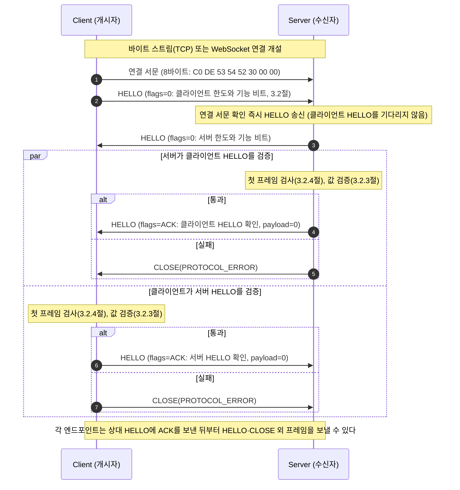
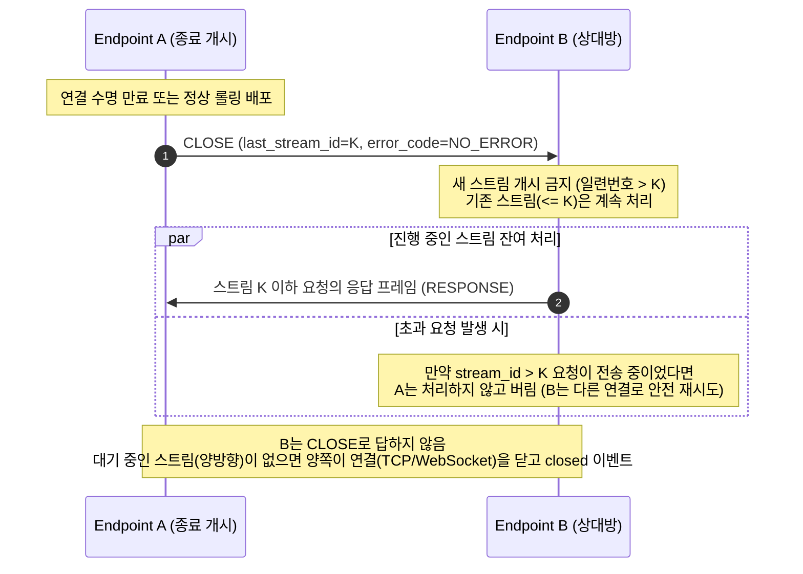
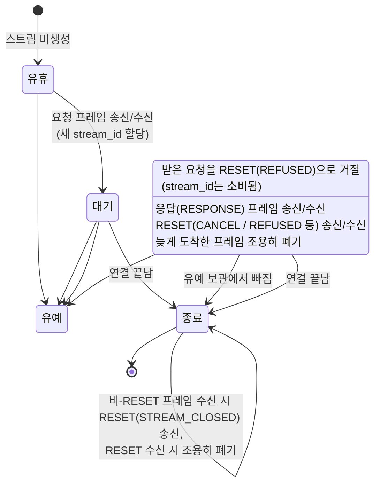

# Strand 규격

* **문서 상태 (Status)**: 초안 (Draft)
* **규격 버전 (Version)**: 0.1.0
* **작성일자 (Date)**: 2026-11-02
* **편집자 (Editor)**: 조정하 (@ppzxc)
* **저장소 (Repository)**: ppzxc/strand

---

## 1. 개요

Strand는 연결 하나로 여러 요청과 응답을 동시에 주고받기 위한 이진 메시지 프로토콜이다. 연결 안에서 요청 하나와 그 응답이 이루는 흐름을 가닥(strand)이라고 부르는데, 프로토콜 이름도 여기서 따왔다.

### 1.1 범위

이 문서는 연결을 맺는 절차, 프레임 형식, 제어 프레임, 파라미터 협상, 오류 처리, 배압, 그리고 연결을 유지하고 끝내는 방법을 다룬다. 반대로 메시지에 무엇을 담을지, 연결을 어떻게 보호할지(6절), 타이머를 몇 초로 둘지 같은 운영 문제는 다루지 않는다.

통신 방식은 한 가지뿐이다. 한 스트림에서 요청이 하나 가고 응답이 하나 돌아온다. 요청은 클라이언트뿐 아니라 서버도 먼저 보낼 수 있다.

분할, 압축 같은 기능은 이 문서에서 다루지 않는다.

### 1.2 공식 사용 환경

Strand 규격은 다음 두 가지를 동등한 공식 1급 사용 환경으로 정의한다.

1. **strand over TCP**:
   - 바이트 스트림 기반 사용 환경. 4바이트 `length` 필드를 읽어 프레임 경계를 구분한다.
   - 내부 마이크로서비스 간 고성능·저지연 통신에 권장된다.

2. **strand over WebSocket** [^RFC6455]:
   - 메시지 기반 사용 환경. 단일 WebSocket 바이너리 메시지(`Opcode 0x02`) 1개에 정확히 Strand 프레임 1개를 싣는다.
   - L7 로드밸런서, API 게이트웨이, 웹 브라우저 환경 통과에 권장된다.
   - 프레임 헤더(16바이트)와 payload 형식, 제어 프레임 및 상태 머신은 strand over TCP와 100% 동일하다.
   - 연결 수립 시 첫 번째 바이너리 메시지로 연결 서문(Connection Preface) 8바이트(3.1절)를 전송하고, 종료 시 Strand `CLOSE` 프레임 송신 후 WebSocket 정상 종료(`Close Frame 0x08`, `1000 Normal Closure`)를 수행한다.

### 1.3 용어

| 용어 (국문 / 영문) | 정의 |
| --- | --- |
| **엔드포인트 (Endpoint)** | 통신 연결의 한쪽 끝단. 물리적 연결을 주도하여 연 쪽을 **클라이언트 (Client)**, 연결을 수락한 쪽을 **서버 (Server)**로 정의 |
| **연결 서문 (Connection Preface)** | 클라이언트가 연결 수립 직후 단 1회 전송하는 8바이트 고정 식별자 (`C0 DE 53 54 52 30 00 00`) |
| **가닥 (Strand)** | 단일 연결 안에서 독립적으로 교환되는 하나의 요청과 그에 대한 단일 응답이 이루는 통신 단위 |
| **스트림 (Stream)** | 동일한 `stream_id`를 공유하는 요청 프레임과 응답 프레임의 논리적 쌍. 스트림당 1개 요청과 1개 응답만 허용 |
| **개시자 비트 (Initiator Bit)** | `stream_id`의 최상위 1비트. 0이면 클라이언트가, 1이면 서버가 연 스트림이다. 두 엔드포인트의 번호 공간을 나눈다(2.2.5절) |
| **일련번호 (Sequence Number)** | `stream_id`에서 개시자 비트를 뺀 나머지 31비트. 개시자마다 1부터 시작해 엄격히 증가하며, 0은 어느 공간에서도 쓰지 않는다. 단조 증가 비교는 같은 개시자 공간 안에서 이 값으로만 한다(2.2.5절) |
| **유휴 스트림 (Idle Stream)** | 개시자가 아직 열지 않은 스트림. 해당 개시자 공간에서 지금까지 쓰인 가장 큰 일련번호보다 큰 번호가 여기에 해당한다. 건너뛴 번호는 유휴 스트림이 아니다(4.2.1절) |
| **개시자 (Initiator)** | 특정 스트림의 요청 프레임을 먼저 전송하여 가닥(Strand)을 시작한 엔드포인트 (클라이언트 또는 서버) |
| **수신자 (Receiver)** | 개시자가 보낸 요청 프레임을 수신하여 처리하고 응답 프레임을 돌려주는 엔드포인트 |
| **프레임 (Frame)** | strand 전송의 기본 단위. 고정 16바이트 헤더, 가변 확장 영역, 가변 본문(payload)으로 구성 |
| **헤더 (Header)** | 모든 프레임 선두에 위치하는 16바이트 고정 크기 영역. 길이, 타입, 플래그, 스트림 식별자, 상태 코드 등을 수록 |
| **제어 프레임 (Control Frame)** | 연결 수명주기, 생존 확인, 정상 종료, 스트림 중단 등 세션 상태를 관리하는 프레임 (`type` < `0x0100`) |
| **애플리케이션 프레임 (Application Frame)** | 실제 비즈니스 서비스의 요청 및 응답 데이터를 운반하는 프레임 (`type` ≥ `0x0100`) |
| **확장 영역 (Extension Area)** | 헤더와 본문 사이에 위치하는 선택적 메타데이터 영역. TLV(`tag`, `length`, `value`) 구조로 인코딩 |
| **본문 (Payload)** | 프레임에 실리는 실제 데이터 바이트열. 제어 프레임은 고정 바이너리 형식을, 애플리케이션 프레임은 Protocol Buffers 이진 인코딩을 따름 |
| **기능 비트 (Capabilities Bitset)** | HELLO 프레임에서 교환하는 32비트 비트셋. 양 엔드포인트가 모두 켠 비트의 기능만 해당 연결에서 활성화 |
| **배압 (Backpressure)** | 수신자의 버퍼 용량을 초과하지 않도록 송신량을 제어하는 메커니즘. 소켓을 블로킹하지 않고 미응답 바이트가 한도를 넘으면 그 요청을 즉시 거절 |
| **유예 상태 (Draining State)** | 스트림이 응답이나 RESET을 보내거나 받아 끝난 직후, 지연 도착하는 프레임을 안전하게 폐기하려고 잠시 유지하는 상태(4.3절) |
| **미응답 바이트 (Pending Bytes)** | 아직 응답이나 RESET으로 끝나지 않은 요청 프레임의 와이어 크기(`4 + length`) 합(4.5절) |

### 1.4 표기 규칙

- 연결 서문, 프레임 헤더, 확장 영역, 제어 프레임 payload에 들어가는 고정 길이 정수는 모두 big-endian, unsigned로 읽는다. 애플리케이션 payload는 Protocol Buffers 이진 인코딩 규칙을 따른다 [^PROTOBUF-ENCODING].
- 필드와 파라미터 이름은 `snake_case`, 프레임 타입·플래그·코드 상수는 `UPPER_SNAKE_CASE`로 쓴다.
- MUST, MUST NOT, SHOULD, SHOULD NOT, MAY는 대문자로 쓴 경우에만 요구 수준을 뜻한다 [^RFC2119] [^RFC8174].
- `0x`가 붙은 수는 16진수이고, KiB·MiB는 1,024의 배수다.

---

## 2. 프레임 기초

### 2.1 기본 프레임 구조

프레임은 16바이트 고정 헤더 뒤에 확장 영역과 본문(payload)이 차례로 붙는 구조다. 헤더 필드는 모두 자기 크기의 배수가 되는 위치에서 시작하도록 배치했다.

```
 0                   1                   2                   3
 0 1 2 3 4 5 6 7 8 9 0 1 2 3 4 5 6 7 8 9 0 1 2 3 4 5 6 7 8 9 0 1
+---------------------------------------------------------------+
|                            length                             |  0
+-------------------------------+---------------+---------------+
|             type              |     flags     |    status     |  4
+-+-----------------------------+---------------+---------------+
|I|                         stream_id                           |  8
+-+-----------------------------+-------------------------------+
|       extensions_length       |           reserved            | 12
+-------------------------------+-------------------------------+
|              extensions (extensions_length 바이트)          ...  16
+---------------------------------------------------------------+
|              payload (나머지)                               ...
+---------------------------------------------------------------+
```

| 위치 | 크기 | 필드 |
| --- | --- | --- |
| 0 | 4 | `length` |
| 4 | 2 | `type` |
| 6 | 1 | `flags` |
| 7 | 1 | `status` |
| 8 | 4 | `stream_id` (최상위 비트 I 포함) |
| 12 | 2 | `extensions_length` |
| 14 | 2 | `reserved` |
| 16 | 가변 | `extensions` |
| 16 + `extensions_length` | 가변 | `payload` |

프레임 전체 크기는 4 + `length`이고, payload 크기는 `length`에서 12와 `extensions_length`를 뺀 값이다. 확장 영역과 본문이 모두 비면 16바이트가 되는데, 이것이 가장 작은 프레임이다. 이 버전에서는 프레임 하나가 곧 메시지 하나다.

### 2.2 헤더 필드

#### 2.2.1 length (4바이트)

이 필드 바로 뒤부터 프레임 끝까지의 바이트 수다. 최솟값은 12이고, 최댓값은 받는 쪽이 알린 `max_frame_size`에서 4를 뺀 값이다. 받는 쪽은 언제나 자기가 알린 `max_frame_size`로 검사한다. 범위를 벗어난 프레임이 오면 `CLOSE(FRAME_SIZE_ERROR)`를 보내고 연결을 닫는다(MUST).

#### 2.2.2 type (2바이트)

프레임 종류를 나타낸다. `0x0000`부터 `0x00FF`까지는 제어 프레임(3절 및 4절), `0x0100`부터 `0xFFFF`까지는 애플리케이션 프레임에 쓴다(4.1절). 응답 프레임에는 요청과 같은 `type` 값을 넣는다(MUST). 제어 프레임 타입 중 `0x0005`\~`0x00FF`는 예약된 타입이며, 받으면 무시한다(MUST). 이때 `stream_id`는 검사하지 않는다.

#### 2.2.3 flags (1바이트)

2.3절에서 따로 설명한다.

#### 2.2.4 status (1바이트)

애플리케이션 요청을 처리한 결과다. 값의 의미는 2.5.1절에 있다. 이 필드는 애플리케이션 응답에서만 의미가 있으므로, 그 밖의 프레임에서는 0으로 보내고 받는 쪽은 값을 보지 않는다(MUST).

#### 2.2.5 stream\_id (4바이트)

가장 앞의 1비트(I)는 이 스트림을 누가 열었는지를 나타낸다. 0이면 클라이언트, 1이면 서버다. 나머지 31비트가 일련번호다.

0번은 연결 전체를 다루는 제어 프레임 전용이다. HELLO·PING·CLOSE의 `stream_id`는 정확히 `0x00000000`이어야 한다(MUST). 위반하면 5.1.1절 5번 검사에서 `CLOSE(PROTOCOL_ERROR)`로 처리한다.

새 스트림을 열 때는 자기 번호 공간에서 1부터 시작해 매번 이전보다 큰 일련번호를 쓴다(MUST). 건너뛰는 것은 허용하며, 건너뛴 번호는 영원히 쓰이지 않는다. 일련번호 0, 곧 `0x00000000`과 `0x80000000`은 어느 공간에서도 쓰지 않는다. 애플리케이션 프레임이나 RESET에서 이 두 값을 받으면 `CLOSE(PROTOCOL_ERROR)`로 처리한다. 3.5절에서 설명하는 CLOSE의 보장이 바로 이 성질에 기대고 있다. 번호를 다 쓰면 CLOSE를 보내고 새 연결을 맺으면 된다.

번호의 크기 비교는 같은 개시자 공간 안에서 31비트 일련번호끼리만 한다. `stream_id` 전체를 부호 있는 정수로 비교하면 서버 개시 스트림(최상위 비트 1)이 음수가 되어 순서가 뒤집히므로 그렇게 비교해서는 안 된다(MUST NOT). 수신자는 두 값을 유지한다.
* `highest_peer_seq`: 상대 공간에서 지금까지 새 스트림으로 인정한 가장 큰 일련번호(처음에는 0)
* `highest_local_seq`: 내 공간에서 지금까지 쓴 가장 큰 일련번호(처음에는 0)

> 비규범 주석: 같은 개시자 공간 안에서 31비트 일련번호를 비교한 결과는 `stream_id`를 32비트 unsigned로 비교한 결과와 같다. unsigned 정수가 없는 언어에서 부호 때문에 비교를 틀리지 않도록 일련번호로 비교하게 했다.

내 공간에서는 `highest_local_seq`보다 큰 번호, 상대 공간에서는 `highest_peer_seq`보다 큰 번호가 가리키는, 아직 열리지 않은 스트림을 유휴 스트림이라 한다. 유휴 스트림을 가리키는 프레임의 처리는 4.2절에 있다.

`stream_id`는 같은 연결 안에서만 유일하다. 연결이 바뀌어도 같은 요청임을 알아봐야 할 때는 `idempotency-key` 확장(2.4절)을 쓴다.

#### 2.2.6 extensions\_length (2바이트)

확장 영역의 바이트 수다. 0이면 확장 영역이 없다는 뜻이다. `length` − 12나 8,192를 넘으면 오류로 처리한다. 이 오류는 2.4.1절의 형식 위반과 같이 연결 오류이며 `CLOSE(PROTOCOL_ERROR)`로 처리한다(MUST).

#### 2.2.7 reserved (2바이트)

항상 0으로 보내고, 받은 값은 무시한다(MUST).

### 2.3 플래그

플래그의 뜻은 프레임 `type`마다 다르다.

| `type` | `0x01` | `0x02` |
| --- | --- | --- |
| HELLO, PING | `ACK` | — |
| CLOSE, RESET | — | — |
| 애플리케이션 (`type` ≥ `0x0100`) | `RESPONSE` | `END` |

* `ACK`: HELLO·PING에 대한 확인이다.
* `RESPONSE`: 응답 프레임임을 표시한다(2.3.1절).
* `END`: 메시지의 마지막 프레임이다. 이 버전에서는 항상 1이다(2.3.2절).

규칙은 하나다. 해당 `type`에 의미가 정의되지 않은 비트(표의 —)와 `0x04`\~`0x80`은 0으로 보내고(MUST), 받으면 무시한다(MUST). 따라서 CLOSE·RESET의 `flags`를 따로 검사하는 단계는 없다.

#### 2.3.1 RESPONSE

응답인지 아닌지는 사실 개시자 비트(I)만 봐도 알 수 있다. `RESPONSE`와 개시자 비트가 가리키는 정보는 겹치므로 두 값은 항상 맞아떨어져야 한다. 이 대조는 `RESPONSE`가 정의된 `type`, 곧 애플리케이션 프레임에만 적용한다. 제어 프레임의 `0x01`(`ACK`)은 개시자 비트와 대조하지 않는다.

| 받은 프레임 (애플리케이션) | 판단 |
| --- | --- |
| 내가 연 스트림, `RESPONSE` 있음 | 내 요청에 대한 응답 |
| 상대가 연 스트림, `RESPONSE` 없음 | 상대의 새 요청 |
| 내가 연 스트림, `RESPONSE` 없음 | 오류: `RESET(PROTOCOL_ERROR)` |
| 상대가 연 스트림, `RESPONSE` 있음 | 오류: `RESET(PROTOCOL_ERROR)` |

두 오류 행은 대기 중인 스트림과 방금 열린 새 스트림에만 적용한다. 아직 열리지 않은 유휴 스트림을 가리키는 프레임은 5.1.1절 6번의 연결 오류다(4.2.1절). 내 요청 스트림이 이 오류(2.3.2절의 `END` = 0 포함)로 끝나면 와이어로는 `RESET(PROTOCOL_ERROR)`만 보내고, 애플리케이션에 넘기는 결과는 4.4절의 표가 정한다. 검사 순서는 5.1절에 있다.

#### 2.3.2 END

이 버전에서는 모든 애플리케이션 프레임에 `END`를 1로 설정한다(MUST). 0인 프레임을 받으면 `RESET(PROTOCOL_ERROR)`으로 처리한다(5.1.2절 8번, 대기 중이거나 방금 열린 스트림에 한한다).

#### 2.3.3 제어 프레임의 플래그

제어 프레임의 플래그는 2.3절의 표를 따른다.

| 구분 | 규칙 |
| --- | --- |
| 원칙 | `ACK`는 HELLO와 PING에서만 의미가 있고, 그 밖의 비트는 모두 0으로 보낸다(MUST). 받는 쪽은 정의되지 않은 비트를 무시하므로 RESET·CLOSE에 어떤 비트가 켜져 와도 오류로 처리하지 않는다 |
| 예외 | 연결 첫 프레임은 `flags == 0`이어야 한다(3.2.4절) |

### 2.4 확장 영역

확장 영역은 요청에 덧붙이는 부가 정보를 담는 곳이다. 항목마다 자기 길이를 들고 있어서, 받는 쪽은 모르는 항목을 그냥 건너뛰면 된다. 덕분에 새 항목을 추가해도 이전 버전 구현과 문제없이 섞어 쓸 수 있다.

#### 2.4.1 항목 형식

```
+-------------------------------+-------------------------------+
|              tag              |            length             |
+-------------------------------+-------------------------------+
|                     value (length 바이트)                  ...
+---------------------------------------------------------------+
```

항목 사이에는 패딩이 없다. 각 항목의 (4 + `length`)를 모두 더한 값은 `extensions_length`와 정확히 같아야 한다(MUST). 한 프레임에 같은 `tag`를 두 번 쓸 수 없고, 항목은 64개까지 둘 수 있다. 이를 어기거나 금지 tag(2.4.2절)가 있으면 확장 영역 형식 위반이며 `CLOSE(PROTOCOL_ERROR)`로 처리한다(MUST).

#### 2.4.2 tag 범위

| 범위 | 분류 | 모르는 tag를 받았을 때 |
| --- | --- | --- |
| `0x0000`, `0xFFFF` | 금지 | 프로토콜 오류 |
| `0x0001`\~`0x7FFF` | 선택 | 건너뛴다 |
| `0x8000`\~`0xFFFE` | 필수 | 요청: 그 요청을 `status` = `UNIMPLEMENTED`로 거절한다. 응답: 와이어로는 아무것도 보내지 않고, 애플리케이션에 로컬 `status` = `UNIMPLEMENTED` 결과를 넘긴다 |

필수 범위는 받는 쪽이 이해하지 못하면 요청을 제대로 처리할 수 없는 항목을 위해 남겨 둔 것이다. 이 버전에는 아직 필수 항목이 없다.

응답에 모르는 필수 tag가 붙어 온 경우의 처리와 응답 해석 실패의 우선순위는 4.1절에 있다.

#### 2.4.3 정의된 항목

| tag | 이름 | 값 | 의미 |
| --- | --- | --- | --- |
| `0x0001` | `timeout` | u32, 밀리초 | 요청 후 이 시간이 지나면 애플리케이션은 결과를 기다리지 않는다 |
| `0x0002` | `traceparent` | ASCII 문자열 | 분산 추적 문맥 [^W3C-TRACE-CONTEXT] |
| `0x0003` | `idempotency-key` | 바이트열, 1\~64바이트 | 같은 요청의 재전송을 식별하는 키 |

`timeout`은 요청을 받은 시점부터 센다. 장비마다 시계가 다를 수 있어서 절대 시각은 쓰지 않는다. 시간이 다 되면 받는 쪽은 처리를 멈추고 `DEADLINE_EXCEEDED`로 응답하는 것이 좋다(SHOULD).

확장 항목은 요청에만 붙이고, 응답의 확장 영역은 비워 둔다(SHOULD). 필수 범위(`0x8000`\~`0xFFFE`) tag는 그 tag를 정의한 확장이 응답에 실어도 된다고 명시하고, 해당 기능 비트가 이 연결에서 협상된 경우에만 응답에 싣는다. 그 밖의 경우에는 싣지 않는다(MUST NOT). 2.4.2절의 응답 수신 규칙은 상대가 이를 어겼을 때의 안전망이다.

#### 2.4.4 제어 프레임의 확장 영역

제어 프레임(HELLO·PING·CLOSE·RESET)은 확장 영역을 비워서 보낸다(MUST). 받는 쪽은 확장 영역의 형식(길이·TLV·금지 tag·중복·64개 한도)만 검사하고(2.4.1절), 내용은 tag 범위와 상관없이(필수 범위 포함) 무시한다(MUST). 정의되지 않은 것은 0으로 보내고 받으면 무시한다는 2.3절의 방식과 같다. 첫 프레임 검사(3.2.4절)의 엄격한 요구는 그대로 유지한다.

### 2.5 코드 체계

코드는 두 종류다. 요청을 처리한 결과는 응답 헤더의 `status`에 담고, 연결이나 스트림을 끊는 이유는 CLOSE·RESET의 `error_code`에 담는다.

#### 2.5.1 status (애플리케이션 결과)

`status`에는 여러 RPC 시스템이 함께 쓰는 상태 코드 체계를 그대로 가져왔다 [^GOOGLE-RPC].

| 값 | 이름 | 쓰임새 |
| --- | --- | --- |
| 0 | `OK` | 성공 |
| 1 | `CANCELLED` | 애플리케이션이 취소함 |
| 2 | `UNKNOWN` | 분류되지 않는 오류 |
| 3 | `INVALID_ARGUMENT` | 요청 값이 잘못됨. 요청 payload를 해석할 수 없음 |
| 4 | `DEADLINE_EXCEEDED` | `timeout` 초과 |
| 5 | `NOT_FOUND` | 대상이 없음 |
| 6 | `ALREADY_EXISTS` | 이미 존재함 |
| 7 | `PERMISSION_DENIED` | 신원은 확인됐으나 권한이 없음 |
| 8 | `RESOURCE_EXHAUSTED` | 한도·할당량 초과 |
| 9 | `FAILED_PRECONDITION` | 현재 상태에서는 수행할 수 없음 |
| 10 | `ABORTED` | 동시 작업과 충돌 |
| 11 | `OUT_OF_RANGE` | 범위를 벗어난 값 |
| 12 | `UNIMPLEMENTED` | 모르는 `type`, 요청에 붙은 모르는 필수 확장. 응답에 붙은 모르는 필수 확장을 받은 쪽이 애플리케이션에 로컬로 넘기는 결과에도 쓴다 |
| 13 | `INTERNAL` | 내부 오류. 받은 응답의 `type` 불일치나 payload 해석 실패를 받은 쪽이 애플리케이션에 로컬로 넘기는 결과에도 쓴다. |
| 14 | `UNAVAILABLE` | 일시적으로 처리할 수 없음. 상대가 보낸 `UNAVAILABLE`은 재시도 가능이다. 연결이 끝날 때 대기 중이던 내 요청의 로컬 결과에도 쓰지만(3.5절), 그 로컬 결과는 처리 여부를 알 수 없으므로 재시도 가능 여부를 정하지 않고 재시도는 3.5절과 4.6절이 정한다 |
| 15 | `DATA_LOSS` | 복구할 수 없는 데이터 손실 |
| 16 | `UNAUTHENTICATED` | 신원을 확인할 수 없음 |
| 17\~255 | 예약 | 받으면 `UNKNOWN`으로 취급 |

`status`가 `OK`가 아닌 응답의 payload는 비워 두거나, Protocol Buffers 이진 인코딩으로 만든 오류 상세 메시지(`google.rpc.Status`)를 넣는다(MUST) [^GOOGLE-RPC]. 이때 메시지 안의 코드는 헤더의 `status`와 같아야 한다(MUST). 프로토콜 계층은 이 payload를 해석하지 않고 그대로 넘긴다.

#### 2.5.2 error\_code (세션/스트림 중단 사유)

| 값 | 이름 | 쓰임새 |
| --- | --- | --- |
| 0 | `NO_ERROR` | 정상 종료 |
| 1 | `PROTOCOL_ERROR` | 이 문서의 규칙 위반 |
| 2 | `INTERNAL_ERROR` | 엔드포인트 내부 오류 |
| 3 | `FRAME_SIZE_ERROR` | 프레임 또는 제어 payload 크기가 맞지 않음 |
| 4 | `HELLO_TIMEOUT` | HELLO에 대한 `ACK`가 오지 않음 |
| 5 | `STREAM_CLOSED` | 이미 끝난 스트림에 프레임이 옴 |
| 6 | `REFUSED` | 처리를 시작하지 않고 거절함. 다시 보내도 안전 |
| 7 | `CANCEL` | 스트림을 더 이상 처리하지 않음 |
| 8 | `OVERLOAD` | 과부하 또는 과도한 사용 |
| 9\~ | 예약 | 받으면 `INTERNAL_ERROR`로 취급 |

---

## 3. 연결 수명주기

Strand는 두 엔드포인트 사이에 순서가 보장되는 양방향 전송 채널이 열린 뒤부터 시작한다. 채널을 보호하는 방법은 6절을 참고한다.

### 3.1 연결 서문 (Connection Preface)

연결이 열리면 클라이언트는 무엇보다 먼저 아래 8바이트 연결 서문(Connection Preface)을 보낸다(MUST). strand over WebSocket에서는 이를 첫 번째 바이너리 메시지로 보낸다.

```
C0 DE 53 54 52 30 00 00
└─┬─┘ └────┬────┘ └─┬─┘
 식별값  "STR0"     예약(0)
```

서버는 앞 6바이트가 이 값과 다르면 아무 응답 없이 연결을 끊는다(MUST). 마지막 2바이트는 예약 영역이라 0으로 보내고, 받는 쪽에서는 보지 않는다.

`"STR0"`의 `0`이 이 프로토콜의 메이저 버전이다. 버전 번호는 여기 한 곳에만 있고, 값이 다르면 서로 통신할 수 없다. 같은 버전 안에서 기능을 늘릴 때는 버전을 올리는 대신 기능 비트(3.2절)를 쓴다.

연결 서문은 엉뚱한 상대를 걸러내는 용도일 뿐 보안 장치는 아니다.

서버는 연결 서문을 보내지 않는다. 서버가 보내는 첫 프레임은 HELLO다(3.2절).

### 3.2 HELLO 및 파라미터 협상

HELLO는 연결마다 한 번, 내가 받을 수 있는 한도와 지원하는 기능을 상대에게 알리는 프레임이다. 제어 프레임의 payload는 외부 직렬화 라이브러리 없이 읽을 수 있도록 고정된 바이너리 형식을 사용한다.

* **type**: `0x0001`
* **stream_id**: `0`
* **payload**: `(identifier u16, value u32)`의 반복. 확인은 `ACK` 플래그 + 빈 payload (길이 0).

한 연결에서 HELLO 프레임은 엔드포인트마다 파라미터 HELLO(`flags = 0`) 하나와 상대 HELLO를 확인하는 ACK HELLO(`flags = ACK`) 하나다.

#### 3.2.1 파라미터 정의

| identifier | 이름 | 기본값 | 보내는 쪽 | 의미 |
| --- | --- | --- | --- | --- |
| `0x0001` | `max_frame_size` | 4,194,304 (4 MiB) | 양쪽 | 받을 수 있는 프레임의 최대 크기. 곧 메시지 최대 크기. 허용 범위 16 KiB\~16 MiB(벗어나면 3.2.3절) |
| `0x0002` | `max_concurrent_streams` | 100 | 양쪽 | 상대가 동시에 열 수 있는 스트림 수. 범위 `0`\~`2^32-1` |
| `0x0003` | `capabilities` | 0 | 양쪽 | 기능 비트셋. 이 버전에서는 모든 비트가 예약 |

#### 3.2.2 HELLO 송신

HELLO 송신 규칙은 다음과 같다(모두 MUST).

1. **독립 프레임**: 엔드포인트는 파라미터 `HELLO(flags=0)`와 확인용 `HELLO(flags=ACK, payload 길이 0)`를 서로 다른 두 프레임으로 보낸다. 둘을 합친 프레임(ACK이면서 payload가 비어 있지 않은 HELLO)은 허용하지 않으며, 받으면 3.2.5절에 따라 `CLOSE(FRAME_SIZE_ERROR)`로 처리한다.
2. **순서**: 파라미터 HELLO가 먼저이고 상대 HELLO에 대한 ACK HELLO가 나중이다.
3. **송신 시점**: 서버는 연결 서문을 확인한 즉시(3.1절) 자기 파라미터 HELLO를 보낸다. 클라이언트 HELLO를 기다리지 않는다. 클라이언트는 연결 서문에 이어 곧바로 보낸다(3.3절).

#### 3.2.3 협상 규칙

모르는 identifier는 무시한다(MUST). 같은 identifier가 두 번 나오면 모르는 identifier라도 연결 오류이며 `CLOSE(PROTOCOL_ERROR)`로 처리한다(MUST). 확장 영역의 중복 tag 금지(2.4.1절)와 같은 규칙이다.

`max_*` 값은 보낸 쪽이 받아들일 수 있는 한도다. 그러니 각 엔드포인트는 상대가 알려 준 한도를 넘지 않게 보내야 한다(MUST). 상대 HELLO를 받기 전에 보내는 프레임은 상대의 `max_frame_size`를 허용 범위의 최솟값 16 KiB로 보고 보낸다(MUST).

각 엔드포인트는 상대 HELLO가 첫 프레임 검사(3.2.4절)를 통과하면 payload를 검증한다(MUST). `max_frame_size`가 허용 범위(16 KiB\~16 MiB) 밖이면 검증에 실패한 것이다. 통과하면 상대 HELLO에 ACK HELLO로 답하고, 실패하면 ACK 대신 `CLOSE(PROTOCOL_ERROR)`를 보내고 닫는다. 서버와 클라이언트가 같은 규칙을 쓴다.

연결에서 실제로 쓸 수 있는 기능은 양쪽 `capabilities`에 공통으로 켜진 비트뿐이다.

HELLO는 연결 도중에 다시 보내지 않는다. 값을 바꾸고 싶으면 새 연결을 맺는다.

#### 3.2.4 첫 프레임 검사

각 엔드포인트는 상대에게서 처음 받는 프레임(첫 프레임)의 헤더만 읽은 상태에서, payload를 읽기 전에 아래를 확인한다(MUST). 하나라도 어긋나면 아무것도 보내지 않고 연결을 닫는다. 서버에게 첫 프레임은 연결 서문 다음에 오는 프레임이고, 클라이언트에게는 서버가 보낸 첫 프레임이다. 서버는 연결 서문을 확인한 즉시 HELLO를 보내므로(3.2.2절), 첫 프레임 검사에 실패해 닫을 때 이미 보낸 HELLO가 있을 수 있다.

1. `type`이 `0x0001`(HELLO)인가
2. `stream_id`와 `flags`가 모두 0인가

#### 3.2.5 HELLO 형태 위반

첫 프레임 검사를 통과한 뒤에도 HELLO 형태가 어긋나면 연결 오류다. 아래는 모두 5.1.1절 5번 검사에서 걸리는 연결 오류이며 해당 `CLOSE`를 보내고 닫는다(MUST).

| 위반 | 오류 코드 |
| --- | --- |
| 파라미터 HELLO의 payload 길이가 6의 배수가 아님 | `CLOSE(FRAME_SIZE_ERROR)` |
| ACK HELLO의 payload가 비어 있지 않음 | `CLOSE(FRAME_SIZE_ERROR)` |
| 파라미터 HELLO를 두 번째로 받음 | `CLOSE(PROTOCOL_ERROR)` |
| 내가 보낸 HELLO에 대한 ACK를 두 번째로 받음 | `CLOSE(PROTOCOL_ERROR)` |

한 프레임이 여러 행에 해당할 때 어느 행의 오류 코드를 쓰는지는 5.1.1절 5번 아래 규칙이 정한다(표의 위 행부터 본다). 예를 들어 payload가 비어 있지 않은 ACK HELLO를 두 번째로 받으면 `CLOSE(FRAME_SIZE_ERROR)`다. `stream_id` 위반(2.2.5절)은 이 표보다 먼저 걸린다.

### 3.3 수립 순서

1. 클라이언트는 연결 서문을 보내고 곧바로 파라미터 HELLO를 이어 보낸다(MUST).
2. 서버는 연결 서문을 3.1절 기준으로 확인한 즉시 자기 파라미터 HELLO를 보낸다(3.2.2절).
3. 양쪽은 상대 HELLO를 받으면 3.2.4절 첫 프레임 검사와 3.2.3절 검증을 하고, 통과하면 ACK HELLO로 답한다. 실패하면 3.2.3절에 따라 닫는다.

**송신 규칙.** HELLO·CLOSE 외 모든 프레임은 상대 HELLO에 ACK를 보낸 뒤에만 보낸다(MUST). 서버는 클라이언트 HELLO에 ACK를 보낸 직후부터 보낼 수 있고 클라이언트의 ACK를 기다리지 않는다. 클라이언트는 서버 HELLO를 검증하고 ACK를 보낸 뒤부터 보낼 수 있다. "수립 완료" 같은 별도 상태는 없다.

**수신 규칙(ACK 관문).** 내가 보낸 HELLO에 대한 상대의 ACK를 받기 전에는 HELLO와 CLOSE만 받는다. 그 전에 PING·RESET·애플리케이션 프레임이 오면 연결 오류이며 `CLOSE(PROTOCOL_ERROR)`로 처리한다(MUST). 예약 제어 타입(2.2.2절)은 어느 때든 무시한다.

**확인 대기.** HELLO ACK나 PING ACK를 기다리다 정해 둔 시간이 지나면 `CLOSE(PROTOCOL_ERROR)`를 보내고 닫는다(MUST). 대기 시간의 값은 로컬 설정이다.



### 3.4 생존 확인: PING

PING은 어느 쪽이든 보낼 수 있다.
* **type**: `0x0002`
* **stream_id**: `0`
* **payload**: 정확히 8바이트 (임의의 바이트열)

받은 쪽은 같은 8바이트에 `ACK` 플래그(`flags = 0x01`)를 붙여 즉시 돌려준다(MUST). payload 길이가 정확히 8바이트가 아니면 `CLOSE(FRAME_SIZE_ERROR)`로 처리한다. ACK를 기다리는 시간의 한도는 3.3절의 확인 대기 규칙을 따른다.

서버는 한동안 아무 프레임도 오지 않는 연결을 `CLOSE(NO_ERROR)`로 정리해도 된다(MAY). PING이 지나치게 자주 오면 `CLOSE(OVERLOAD)`로 끊을 수도 있다(MAY).

### 3.5 연결 종료: CLOSE

CLOSE는 연결 전체의 종료를 알리는 프레임이다.
* **type**: `0x0003`
* **stream_id**: `0`
* **payload**: `last_stream_id` u32 (4B) + `error_code` u32 (4B) + `reason` 가변 (UTF-8 문자열, 0B 이상)

```
CLOSE payload
+-----------------------------+
|      last_stream_id (32)    |
+-----------------------------+
|        error_code (32)      |
+-----------------------------+
|      reason (가변, UTF-8) ...
+-----------------------------+
```

payload 길이가 8바이트 미만이면 `CLOSE(FRAME_SIZE_ERROR)`로 처리한다. `reason`은 사람이 읽으라고 넣는 설명이며, 프로그램 동작이 이 값에 기대서는 안 된다.

CLOSE를 보내는 쪽은 `last_stream_id`에 CLOSE를 보내는 시점의 `highest_peer_seq`, 곧 상대가 연 스트림 가운데 지금까지 쓰인 가장 큰 번호를 적는다. 정상 종료든 연결 오류든 같다. CLOSE를 받은 쪽은 그 연결에서 새 스트림을 열지 않는다(MUST). 애플리케이션이 그 뒤에 새 요청을 보내려 하면 구현은 프레임을 보내지 않고 애플리케이션에 `UNAVAILABLE`로 실패를 알린다(MUST). 이 실패는 스트림을 열기 전의 로컬 결과라서 `stream_id`가 없다.

`last_stream_id`는 개시자 비트를 포함한 32비트 `stream_id`를 그대로 적는다. 서버가 보낸 CLOSE에는 클라이언트가 연 번호(`1`, `2`, ...)가, 클라이언트가 보낸 CLOSE에는 서버가 연 번호(`0x80000001`, ...)가 들어간다. `0x00000000`은 "처리한 스트림 없음"을 뜻하는 특수값이다. 클라이언트가 보내는 경우에도 `0x80000000`이 아니라 `0x00000000`을 쓴다.

송신자는 `last_stream_id`를 CLOSE를 보내는 시점의 `highest_peer_seq`와 정확히 같게 적어야 한다(MUST). 더 작은 값을 적지 않는다. 부하를 줄이려고 일부 요청을 받지 않으려면 `RESET(REFUSED)`로 거절한다(4.5절). 그렇게 거절했거나 처리하지 않은 요청의 번호도 `highest_peer_seq`에 들어 있으므로 `last_stream_id` 이하일 수 있다(4.2.1절). `last_stream_id`보다 큰 일련번호로 온 요청은 처리하지 않는다(MUST NOT).

CLOSE를 보낸 쪽이 그 뒤에 받은 새 요청(상대 공간 번호이고 `RESPONSE`=0인 애플리케이션 프레임) 중 일련번호가 `last_stream_id`보다 큰 것은 애플리케이션에 전달하지 않고, 아무것도 보내지 않고 버린다(MUST). `RESET(REFUSED)`도 보내지 않는다. 이 폐기는 5.1.1절 6번 검사를 통과한 직후, 5.1.2절 7번 검사 앞에서 한다. 그러므로 8번, 9번 검사의 `RESET`은 나오지 않는다. 번호는 5.1.1절 6번을 통과하면서 `highest_peer_seq`에 반영된다(4.2.1절).

`last_stream_id`보다 큰 번호로 보낸 요청은 처리되지 않았다는 것이 보장된다. 그래서 다른 연결로 다시 보내도 중복될 걱정이 없다.

엔드포인트는 CLOSE를 한 번만 보낸다(MUST). 다시 보내서는 안 된다(MUST NOT). 양쪽이 동시에 CLOSE를 보내는 것은 허용된다. 이 1회 규칙은 CLOSE를 보내는 규칙이다. 이미 CLOSE를 보냈다면 아래 잘못된 CLOSE 처리에서도 두 번째 CLOSE는 보내지 않는다. 받는 쪽의 두 번째 CLOSE는 아래 닫는 시점 표가 정한다.

형태가 올바른 CLOSE를 받았다는 이유만으로 CLOSE로 답하지 않는다(MUST NOT). 잘못된 CLOSE에는 아래 규칙대로 `CLOSE(PROTOCOL_ERROR)`를 보낸다. 애플리케이션이 연결을 닫으라고 했거나 5.1.1절의 연결 오류가 생겨 CLOSE를 보내는 것은 이와 별개이며, 그 CLOSE도 한 번만 보낸다.

받은 `last_stream_id`가 다음 중 하나이면 잘못된 CLOSE다.
* 0이 아니면서 개시자 비트가 수신자의 번호 공간과 다르다.
* 일련번호가 수신자의 `highest_local_seq`보다 크다. 수신자가 열지 않은 번호를 주장하는 경우다.

잘못된 CLOSE를 받은 수신자의 처리는 다음과 같다.

* 원칙: `CLOSE(PROTOCOL_ERROR)`를 보내고 즉시 연결을 닫는다.
* 예외: 수신자가 이미 CLOSE를 보냈다면 두 번째 CLOSE는 보내지 않고 연결만 닫는다.

대기 중인 요청은 처리 여부를 알 수 없는 것으로 취급하므로, `idempotency-key`가 있는 요청만 다시 보낸다(4.6절).

`error_code`가 `NO_ERROR`이면 정상 종료이고, 그 밖의 코드는 오류로 인한 종료다. 닫는 시점은 아래 표가 정한다. 표에서 "첫 번째"와 "두 번째"는 받은 CLOSE의 순서를 뜻하며 내가 보낸 CLOSE는 세지 않는다. 대기 중인 스트림은 내가 연 것과 상대가 연 것을 모두 센다(4.3절). 유예 상태인 스트림은 세지 않는다. 표는 위 행부터 보고 처음 해당하는 행만 쓴다.

| 상황 | 처리 |
| --- | --- |
| 형태가 잘못된 CLOSE를 받음 (첫 번째·두 번째 무관, 위 잘못된 CLOSE 조건) | 5.1.1절 5번 연결 오류로 처리한다. 이미 CLOSE를 보냈다면 두 번째 CLOSE 없이 닫기만 한다. 내가 먼저 `NO_ERROR` CLOSE를 보냈거나 받아서 마저 끝내는 중이어도, 대기 중인 스트림이 남아 있어도 기다리지 않는다 |
| 비-`NO_ERROR` CLOSE를 보냈다 | 보낸 직후 전송 계층을 닫고 애플리케이션에 `closed` 이벤트를 낸다(MUST). 대기 중인 스트림이 남아 있어도 기다리지 않는다 |
| 두 번째로 받은 CLOSE (`error_code` 무관) | 형태가 올바르면 무시한다(잘못된 CLOSE는 맨 위 행이 처리한다). 먼저 `NO_ERROR` CLOSE를 받아 마저 끝내는 중에 비-`NO_ERROR` CLOSE를 두 번째로 받아도 닫지 않는다 |
| 형태가 올바른 첫 번째 받은 CLOSE가 비-`NO_ERROR` | 아무것도 보내지 않고 전송 계층을 닫고 `closed` 이벤트를 낸다(MUST). 대기 중인 스트림이 남아 있어도 기다리지 않는다. 내가 먼저(또는 동시에) `NO_ERROR` CLOSE를 보냈어도 같다. 받은 오류 CLOSE가 보낸 `NO_ERROR` CLOSE보다 우선한다 |
| 위에 해당하지 않으면서 `NO_ERROR` CLOSE를 보냈거나 받았다 | 진행 중인 스트림을 마저 끝낸다. 대기 중인 스트림이 없으면(처음부터 없는 경우 포함) 곧바로 전송 계층을 닫고 `closed` 이벤트를 낸다(MUST) |

**연결이 끝날 때.** CLOSE를 보내거나 받아 닫을 때(`NO_ERROR`로 마저 끝내는 중에 5.1.1절 연결 오류나 받은 오류 CLOSE로 닫는 경우 포함), 5.1.1절 1번·2번처럼 CLOSE 없이 닫을 때, 상대가 CLOSE 없이 전송 계층을 끊었을 때(TCP EOF·RST, WebSocket close) 모두 연결이 끝난 것이다. 전송 계층이 끊기면 보낼 수 없으므로 아무것도 보내지 않는다. 연결이 끝날 때 응답도 RESET도 받지 못한 채 대기 중인 내 요청마다 애플리케이션에 로컬 `status` = `UNAVAILABLE` 결과를 정확히 한 번 넘기고(MUST), 그 뒤에 `closed` 이벤트를 낸다. `closed`는 연결당 정확히 한 번 낸다. 이미 닫힌 뒤에 전송 계층 끊김이 감지되어도 `closed`를 다시 내지 않고 아무것도 보내지 않는다. `NO_ERROR`로 마저 끝내고 대기 중인 스트림이 없어져 닫을 때도 `closed`는 마지막 스트림의 result(정상 응답 포함) 다음에 낸다(MUST). 이 `status`는 상대가 보낸 것이 아니라 로컬에서 만든 결과다. 상대가 연 스트림은 내 요청이 아니므로 결과를 넘기지 않는다. 이 결과는 재시도 가능 여부를 정하지 않는다. 다시 보내도 되는지는 위 `last_stream_id` 보장과 4.6절이 정한다.

5.1.1절 1번·2번은 연결 확립 전(연결 서문·첫 프레임 단계)에 걸리므로 대기 중인 내 요청이 없는 것이 보통이다. 그 경우 `UNAVAILABLE` 결과는 없고 `closed` 이벤트만 난다.



---

## 4. 스트림 및 애플리케이션 통신

### 4.1 애플리케이션 프레임

애플리케이션 프레임의 `type`은 `0x0100` 이상의 값으로, 서비스 정의(`.proto`)의 메서드마다 하나씩 붙인다. payload에는 Protocol Buffers 이진 인코딩 [^PROTOBUF-ENCODING]으로 만든 요청이나 응답 메시지가 들어간다.

모르는 `type`으로 요청이 오면 연결은 그대로 두고 `status` = `UNIMPLEMENTED`로 답한다(MUST). 요청 payload를 Protocol Buffers 이진 인코딩으로 해석할 수 없으면 연결은 그대로 두고 `status` = `INVALID_ARGUMENT`로 답한다(MUST). 메시지 형식을 호환되지 않게 바꿔야 할 때는 기존 `type`을 고치지 말고 새 번호를 받는다.

**응답 해석.** 요청한 쪽은 받은 응답이 해석 가능한지 아래 순서로 확인하고, 처음 걸린 하나만 쓴다. 응답 헤더의 `status`가 `OK`가 아니어도 이 확인이 먼저다.

| 순서 | 확인 | 걸리면 애플리케이션에 넘기는 로컬 `status` |
| --- | --- | --- |
| (1) | 응답 `type`이 요청 `type`과 같음(2.2.2절) | `INTERNAL` |
| (2) | 모르는 필수 확장이 없음(2.4.2절) | `UNIMPLEMENTED` |
| (3) | payload를 Protocol Buffers 이진 인코딩으로 해석 가능 | `INTERNAL` |

하나라도 걸리면 와이어로는 아무것도 보내지 않는다(RESET도 CLOSE도 보내지 않는다). 해석에 실패한 응답도 정상 응답을 받은 것과 같게 다룬다(4.3절, 4.5절). 애플리케이션에는 받은 응답 대신 로컬에서 만든 `status` 결과를 넘기며, 응답의 원래 `status`와 payload는 버린다. 이 `status`는 상대가 보낸 것이 아니라 로컬에서 만든 결과이며, 애플리케이션에 이를 구분해 보여 줄지는 구현이 정한다.

```protobuf
syntax = "proto3";
package strand.v1;

import "google/protobuf/descriptor.proto";

extend google.protobuf.MethodOptions {
  uint32 type_code = 50001;   // 50000~99999는 내부 용도용 옵션 번호
}

service MessageService {
  rpc Send(SendRequest) returns (SendResponse) { option (type_code) = 0x0101; }
  rpc Query(QueryRequest) returns (QueryResponse) { option (type_code) = 0x0102; }
}
```

### 4.2 스트림 다중화 및 식별

새 스트림을 열 때는 자기 번호 공간에서 1부터 시작해 매번 이전보다 큰 일련번호를 쓴다(MUST). 번호 비교 방식과 `highest_peer_seq`·`highest_local_seq`는 2.2.5절에 있다.
* **클라이언트 개시 스트림**: 최상위 비트 I = 0 (`stream_id` = 1, 2, 3...)
* **서버 개시 스트림**: 최상위 비트 I = 1 (`stream_id` = `0x80000001`, `0x80000002`...)

애플리케이션 프레임의 `RESPONSE` 플래그와 개시자 비트(I) 일치는 2.3.1절, `END` 플래그는 2.3.2절을 따른다.

#### 4.2.1 새 스트림 판정과 유휴 스트림 참조

상대 공간의 번호이면서 `RESPONSE`=0인 애플리케이션 프레임은 모두 새 스트림을 여는 시도다. 그 일련번호가 `highest_peer_seq` 이하이면(재사용한 번호도, 건너뛰고 나중에 온 번호도 마찬가지다) 5.1.1절 6번 위반이므로 `CLOSE(PROTOCOL_ERROR)`로 처리한다. TCP는 순서를 보장하므로 경합으로 이런 프레임이 생길 수 없다. 그래서 끝난 스트림으로 늦게 온 프레임의 처리 규칙(4.3절)과 충돌하지 않는다.

`highest_peer_seq`는 5.1.1절 6번 검사를 통과하는 즉시 갱신한다. 그 뒤 `RESET(REFUSED)`로 거절했는지, CLOSE 이후라 버렸는지, 그 뒤 검사(5.1.2절, 5.1.3절)에서 실패했는지와 상관없이 그 번호는 쓰인 것으로 센다.

유휴 스트림을 가리키는 다음 프레임은 5.1.1절 6번의 연결 오류이므로 `CLOSE(PROTOCOL_ERROR)`로 처리한다.
* 내 공간 번호인데 일련번호가 `highest_local_seq`보다 큰 애플리케이션 프레임(`RESPONSE` 값과 상관없다) 또는 RESET
* 상대 공간 번호인데 일련번호가 `highest_peer_seq`보다 큰 `RESPONSE` = 1 애플리케이션 프레임 또는 RESET

새 스트림을 여는 시도(상대 공간 번호, `RESPONSE`=0인 애플리케이션 프레임)는 유휴 스트림을 가리켜도 연결 오류가 아니라 위의 새 스트림 판정을 따른다. 일련번호가 해당 공간의 최고값 이하인 끝난 스트림은 이 규칙이 아니라 끝난 스트림의 처리 규칙(4.3절, 5.1.2절 7번)을 따른다.

### 4.3 스트림 생명주기 및 상태 머신

| 상태 | 들어가는 조건 | 나가는 조건 |
| --- | --- | --- |
| 유휴 | `stream_id`를 아직 쓰지 않음 | 요청 프레임을 보냄(받음) → 대기. 받은 요청을 `RESET(REFUSED)`으로 거절 → 유예 상태 |
| 대기 | 요청 프레임을 보냄(받음). 이 순간부터 요청 크기가 미응답 바이트에 들어간다(4.5절) | 응답 프레임 또는 RESET을 보내거나 받음 → 유예 상태. 연결이 끝남(3.5절) → 종료 |
| 유예 상태 | 응답 또는 RESET을 보내거나 받은 즉시. 거절한 요청도 대기를 거치지 않고 바로 들어온다 | 유예 보관에서 빠짐 → 종료. 연결이 끝남(3.5절) → 종료 |
| 종료 | 유예 보관에서 빠짐. 또는 연결이 끝남 | — |

스트림은 응답이나 RESET을 보내거나 받는 즉시 유예 상태로 넘어간다(MUST). 응답을 보냈거나 받은 쪽만이 아니라 RESET을 보낸 쪽과 받은 쪽도 같다.



**유예 상태의 프레임 처리.** 유예 상태인 스트림에 늦게 도착한 프레임(`RESPONSE`든 RESET이든)은 조용히 버린다(MUST). 5.1.2절 7번의 `RESET(STREAM_CLOSED)`을 보내지 않는다. 유예 상태는 전이 조건만 정할 뿐 시간 제한이 없고, 얼마나 오래 두는지는 아래 보관 한도가 정한다.

**유예 보관 한도.** 엔드포인트는 최근에 끝난 스트림의 `stream_id`를 보관해 유예 상태를 유지한다. 보관 한도는 고정 개수 기준(링 버퍼나 LRU)으로 정하거나 시간 기준으로 정한다. 개수 기준을 쓴다면 최근 끝난 스트림 1,024개 이상을 보관한다(SHOULD). 한도를 넘겨 보관에서 빠지면 그 스트림은 종료다.

**종료 스트림의 프레임 처리.** 개시된 뒤 끝났고 유예 보관에서도 빠진 스트림(종료)에 비-RESET 프레임이 도착하면 `RESET(STREAM_CLOSED)`을 보낸다(MUST, 5.1.2절 7번). 종료 스트림에 RESET이 도착하면 아무것도 보내지 않고 버린다(4.4절).

보관 한도는 적합성 검증에서 결정적으로 다룬다 [^STRAND-VECTORS]. 시간에 기대지 않고 개수를 설정해 두고, 한도를 넘기도록 스트림을 끝낸 뒤 처음 끝난 스트림으로 프레임을 보내 `RESET(STREAM_CLOSED)`이 오는지 확인한다. 한도 안에서는 같은 프레임이 조용히 버려지는지 확인한다.

### 4.4 스트림 중단: RESET

RESET은 스트림 하나를 그 자리에서 즉시 중단시키는 제어 프레임이다.
* **type**: `0x0004`
* **stream_id**: 중단 대상 스트림의 `stream_id` (0일 수 없음)
* **flags**: `0` (정의된 플래그 없음, 2.3절)
* **payload**: 정확히 4바이트 (`error_code` u32)

```
RESET payload
+-----------------------------+
|        error_code (32)      |
+-----------------------------+
```

payload 길이가 정확히 4바이트가 아니면 `CLOSE(FRAME_SIZE_ERROR)`로 처리한다.

받은 RESET에는 어떤 경우에도 RESET으로 답하지 않는다(MUST NOT). 대기 상태인 스트림이 RESET을 받으면 유예 상태로 넘어가고(4.3절), 유예 상태나 종료인 스트림에 RESET이 오면 4.3절에 따라 아무것도 보내지 않는다. 서로 RESET을 주고받는 연쇄를 끊기 위해서다.

요청한 쪽이 결과가 더는 필요 없을 때는 `RESET(CANCEL)`을 보낸다. 받은 쪽은 할 수 있으면 처리를 멈추고, 응답은 보내지 않는다.

**RESET으로 끝난 요청의 결과.** 내가 보낸 요청의 스트림이 RESET으로 끝나면(내가 RESET을 보냈든 받았든) 애플리케이션에 로컬 `status` 결과를 정확히 한 번 넘긴다(MUST). 이 `status`는 상대가 보낸 것이 아니라 로컬에서 만든 결과다. 요청을 받은 쪽에는 결과를 기다리는 요청이 없으므로 애플리케이션에 넘기는 결과가 없다.

| 사건 | 애플리케이션에 넘기는 `status` |
| --- | --- |
| 내가 `RESET(CANCEL)`을 보냄 | `CANCELLED` |
| 내가 2.3.1절·2.3.2절 위반으로 `RESET(PROTOCOL_ERROR)`을 보냄 | `INTERNAL` |
| `RESET(CANCEL)`을 받음 | `CANCELLED` |
| `RESET(REFUSED)`를 받음 | `UNAVAILABLE` |
| 그 밖의 RESET을 받음 | `INTERNAL` |

RESET이 아니라 연결이 끝나면서 끝나는 대기 중인 요청의 결과(`UNAVAILABLE`)는 3.5절이 정한다.

### 4.5 배압 (Backpressure)

배압은 응답을 신호로 삼는다. 응답이 돌아오면 그만큼 더 보낼 수 있다. 소켓 읽기를 멈추지 않고, 한도를 넘는 요청은 받는 쪽이 `RESET(REFUSED)`으로 돌려보낸다.

**미응답 바이트.** 요청 하나가 차지하는 크기는 `4 + length`바이트다. 길이 접두부(4바이트), 헤더, 확장 영역, payload를 모두 센 와이어 전체 크기이며 `max_frame_size`와 같은 기준이다. 미응답 바이트는 대기 상태인 스트림의 요청 크기를 모두 더한 값이다. 3.2.3절이 `max_frame_size` ≤ `max_pending_bytes`를 요구하므로, 미응답 바이트가 0이면 프레임 하나는 받아들여진다.

**세는 대상.** 상대가 연 스트림에 도착한 애플리케이션 요청 프레임(`RESPONSE` = 0) 중 5.1.2절 9번 검사를 통과해 받아들인 것만 센다. 응답 프레임, 제어 프레임, 그 앞 검사(5.1.1절, 5.1.2절 7번·8번)에서 걸린 프레임은 세지 않는다.

**동시 스트림 수.** 새 요청이 `max_concurrent_streams`(3.2.1절)를 넘기면 그 요청을 `RESET(REFUSED)`으로 거절한다(MUST).

**거절 경계.** 받는 쪽의 현재 미응답 바이트를 `p`, 새 요청의 크기를 `s`라 하면, `p + s > max_pending_bytes`일 때 그 요청을 `RESET(REFUSED)`으로 거절한다(MUST). `p + s`가 `max_pending_bytes`와 같으면 받아들인다.

**반환 시점.** 스트림이 대기 상태에서 유예 상태로 넘어가는 순간, 그 요청의 크기를 정확히 한 번 전부 미응답 바이트에서 뺀다(MUST). 전이를 일으키는 사건은 쪽마다 다르다.

| 쪽 | 반환을 일으키는 사건 |
| --- | --- |
| 송신 측(요청을 보낸 쪽) | 응답 수신(4.1절의 응답 해석에 실패한 응답 포함), RESET 수신, 자신의 RESET 송신(`RESET(CANCEL)`, 2.3.1절·2.3.2절 위반으로 보내는 `RESET(PROTOCOL_ERROR)`) |
| 수신 측(요청을 받은 쪽) | 응답 송신, 자신의 RESET 송신, 상대의 RESET 수신(`RESET(CANCEL)` 등) |

연결이 끝나면 미응답 바이트 회계를 통째로 버리고 따로 반환하지 않는다.

**거절한 요청.** `RESET(REFUSED)`으로 거절한 요청은 미응답 바이트에도, 동시 스트림 수에도 넣지 않는다. 그 스트림은 대기 상태를 거치지 않고 바로 유예 상태로 들어간다. `stream_id`는 소비된 것으로 보아 5.1.1절 6번의 단조 증가 기준을 갱신한다.

**송신 측 의무.** 보낸 요청 가운데 아직 끝나지 않은 것의 크기 합을 상대의 `max_pending_bytes` 아래로 유지한다(SHOULD).

> 비규범 설명: 송신 측의 반환은 수신 측과 달리 외부에서 직접 관측되지 않는다. 송신 측의 한도 준수가 SHOULD이기 때문이다. 적합성 검증은 같은 사건이 일으키는 유예 전이(4.3절)로 확인하며, 방법은 벡터 형식 문서 1절에 있다 [^STRAND-VECTORS].

> 비규범 설명: 전송 채널이 순서를 보장하므로 위 규칙을 따르면 송신 측의 미응답 바이트는 늘 수신 측의 값 이상이다. 따라서 한도를 지키는 송신자는 잘못된 `REFUSED`를 받지 않는다.

소켓 읽기를 멈춰서는 안 된다(MUST NOT). 읽기를 멈추면 PING, CLOSE, RESET까지 같이 막혀서 상대는 연결이 죽었다고 판단하게 된다. 거절한 요청도 끝까지 읽고 버린다.

### 4.6 다시 보내기 (Retry)

연결이 끊겨 응답을 받지 못한 요청은 새 연결로 다시 보낼 수 있다. CLOSE의 `last_stream_id`보다 큰 번호의 요청은 처리되지 않은 것이 확실하므로(3.5절) 그대로 다시 보내면 된다. 끝난 연결에서 대기 중이던 요청은 애플리케이션에 로컬 `UNAVAILABLE`로 알려지지만(3.5절), 이 값만으로는 처리 여부를 알 수 없고 재시도 가능 여부는 이 절과 `last_stream_id` 보장이 정한다.

나머지 요청은 처리됐는지 알 방법이 없다. 한 번만 처리돼야 하는 요청이라면 `idempotency-key`를 붙여 보낸다(SHOULD). 같은 키로 다시 온 요청을 어떻게 다룰지는 애플리케이션이 정한다.

---

## 5. 수신 프레임 검사 및 오류 처리

오류는 영향을 받는 범위가 가장 좁은 단위에서 처리한다. 요청 하나의 문제면 `status`로 응답하고, 스트림 하나의 문제면 RESET으로 그 스트림만 끊는다. CLOSE로 연결 전체를 닫는 것은 프레임 경계를 더는 믿을 수 없을 때뿐이다.

### 5.1 검사 순서

수신 프레임은 아래 번호 순서로 검사하고, 반응이 정해지면 뒤의 검사는 하지 않는다. 각 검사의 조건과 정확한 오류 코드는 원래 절이 정하고, 이 절은 검사 순서와 반응의 종류만 정한다.

#### 5.1.1 연결 오류 (1~6번)

1번과 2번은 아무것도 보내지 않고 연결을 닫고, 3번~6번은 `CLOSE`를 보내고 닫는다. 이미 CLOSE를 보냈다면 다시 보내지 않고 닫는다(3.5절). 6번 통과 직후에는 CLOSE 이후의 새 요청 폐기(3.5절)가 있다. 1번·2번으로 닫을 때도 대기 중인 내 요청의 `UNAVAILABLE` 결과와 `closed` 이벤트는 3.5절 '연결이 끝날 때' 규칙을 따른다. 연결을 확립하기 전이라 대기 중인 요청이 없으면 해당 없다.

| 번호 | 검사 (원래 절) | 적용 대상 | 실패 시 | 통과 후 |
| --- | --- | --- | --- | --- |
| 1 | 연결 서문 (3.1절) | 서버가 받는 연결 서문 | 닫음 | 2번 |
| 2 | 첫 프레임 (3.2.4절) | 양쪽 엔드포인트가 상대에게서 처음 받는 프레임 | 닫음 | 3번 |
| 3 | `length` 범위 (2.2.1절) | 모든 프레임 | CLOSE | 4번 |
| 4 | 확장 영역 길이·형식 (2.2.6절, 2.4절, 제어 프레임은 2.4.4절) | 모든 프레임 | CLOSE | 예약 제어 타입(`0x0005`\~`0x00FF`, 2.2.2절)은 여기서 무시하고 끝낸다. 그 밖의 제어 프레임은 5번, 애플리케이션 프레임은 6번 |
| 5 | 제어 프레임 형태: `stream_id`(2.2.5절), payload 크기(3.4절, 3.5절, 4.4절, RESET 포함), HELLO 형태(3.2.5절), HELLO 값(3.2.3절), CLOSE의 `last_stream_id`(3.5절) | 예약 타입을 뺀 제어 프레임 | CLOSE | RESET은 6번. HELLO·PING·CLOSE는 해당 처리(3.2절, 3.4절, 3.5절)로 끝낸다 |
| 6 | `stream_id`: 일련번호 0 금지(2.2.5절), 새 스트림의 일련번호 역행, 유휴 스트림 참조(4.2.1절) | 애플리케이션 프레임, RESET | CLOSE | 7번 |

5번 칸의 항목은 적힌 순서(`stream_id`, 제어 프레임 payload 크기, HELLO 형태, HELLO 값, CLOSE의 `last_stream_id`)대로 검사하고, HELLO 형태는 3.2.5절 표의 행 순서대로 검사한다. 처음 걸린 위반이 보낼 `CLOSE`의 코드를 정한다(MUST). 한 프레임이 둘 이상에 걸려도 오류 코드는 하나다.

ACK 관문(3.3절)은 4번을 통과한 프레임 중 HELLO·CLOSE를 뺀 것에 적용하고 5번 앞에서 검사한다. 위반하면 `CLOSE(PROTOCOL_ERROR)`다.

#### 5.1.2 스트림 오류 (7~9번)

해당 스트림만 다루고 연결은 유지한다. 7번이 8번보다 앞서므로 끝난 스트림으로 늦게 온 형식 위반 프레임 때문에 RESET이 나가는 일은 없다.

| 번호 | 검사 (원래 절) | 적용 대상 | 실패·분류 시 | 통과 후 |
| --- | --- | --- | --- | --- |
| 7 | 스트림 상태 분류 (4.3절) | 애플리케이션 프레임, RESET | 유예 상태: 폐기. 끝난 스트림: 비-RESET은 RESET, RESET은 폐기 | 대기 중인 스트림과 새 스트림의 RESET은 RESET 처리(4.4절)로 끝내고 8번을 건너뛴다. 비-RESET은 8번 |
| 8 | `RESPONSE`와 개시자 비트 일치, `END` (2.3.1절, 2.3.2절) | 애플리케이션 프레임(대기 중인 스트림과 새 스트림) | RESET | 요청은 9번, 응답은 12번 |
| 9 | 동시 스트림 수, 미응답 바이트 한도 (4.5절) | 새 요청 | RESET | 10번 |

#### 5.1.3 요청·응답 오류 (10~12번)

RESET도 CLOSE도 보내지 않고 연결은 유지한다. 요청 오류는 `status` 응답으로, 응답 오류는 애플리케이션에만 로컬로 알린다.

| 번호 | 검사 (원래 절) | 적용 대상 | 실패 시 | 통과 후 |
| --- | --- | --- | --- | --- |
| 10 | 모르는 필수 확장, 모르는 `type` (2.4.2절, 4.1절) | 요청 | `status` 응답 | 11번 |
| 11 | payload 해석 (4.1절) | 요청 | `status` 응답 | 애플리케이션에 전달 |
| 12 | 응답 해석: `type` 일치, 모르는 필수 확장, payload 해석 (4.1절) | 응답 | 로컬 `status` (와이어로는 아무것도 보내지 않음) | 애플리케이션에 전달 |

---

## 6. 보안 고려사항

### 6.1 보호 수단 없음

Strand 자체에는 기밀성, 무결성, 상대 인증 기능이 없다. 헤더와 payload는 바이트 스트림에 그대로 실린다. 그러니 신뢰할 수 없는 네트워크를 지나는 환경이라면 이런 보호를 제공하는 채널 위에서 Strand를 써야 한다(SHOULD). 상호 인증을 켠 TLS 1.3이 가장 흔한 선택이다.

### 6.2 멱등 키

멱등 키는 클라이언트가 정하기 때문에 서로 다른 클라이언트의 키가 우연히 같을 수 있다. 받는 쪽이 키만 보고 중복을 판단하면, 어떤 클라이언트의 요청이 처리되지 않고 넘어가거나 다른 클라이언트의 처리 결과가 엉뚱한 곳으로 나갈 수 있다. 그래서 애플리케이션은 키를 인증된 상대별로 나눠서 관리해야 한다.

### 6.3 자원 소모

받는 쪽은 HELLO로 알린 한도(`max_frame_size`, `max_concurrent_streams`)와 확장 영역 한도를 넘는 입력을 받아들이지 않는다.

모르는 것은 무시하라는 규칙(예약 타입, 예약 플래그, 모르는 확장 항목)을 악용한 쓸데없는 트래픽이나 지나치게 잦은 PING은 `CLOSE(OVERLOAD)`로 끊을 수 있다.

### 6.4 사람이 읽는 문자열

CLOSE의 `reason`과 오류 상세 메시지는 상대에게 그대로 전달된다. 내부 경로, 스택 트레이스, 인증 정보 같은 민감한 내용은 넣지 않는다.

---

## 7. 참고문헌

이 규격이 규범으로 인용하는 문서다.

[^RFC2119]: RFC 2119, *Key words for use in RFCs to Indicate Requirement Levels*
[^RFC8174]: RFC 8174, *Ambiguity of Uppercase vs Lowercase in RFC 2119 Key Words*
[^PROTOBUF-ENCODING]: Protocol Buffers, *Encoding*
[^GOOGLE-RPC]: googleapis, `google/rpc/code.proto`, `google/rpc/status.proto`
[^W3C-TRACE-CONTEXT]: W3C, *Trace Context*
[^RFC6455]: RFC 6455, *The WebSocket Protocol*
[^STRAND-VECTORS]: Strand, *Strand 적합성 벡터 형식* (`STRAND_CONFORMANCE_VECTORS.md`). 적합성 벡터와 러너를 만들 때 필요하다
