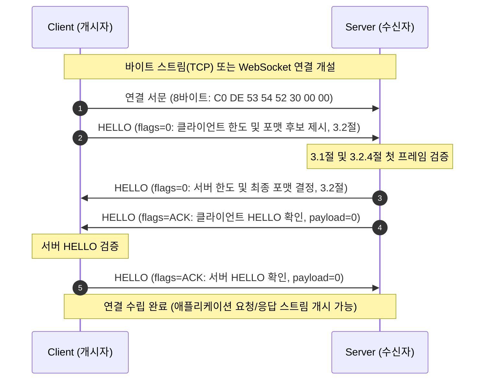
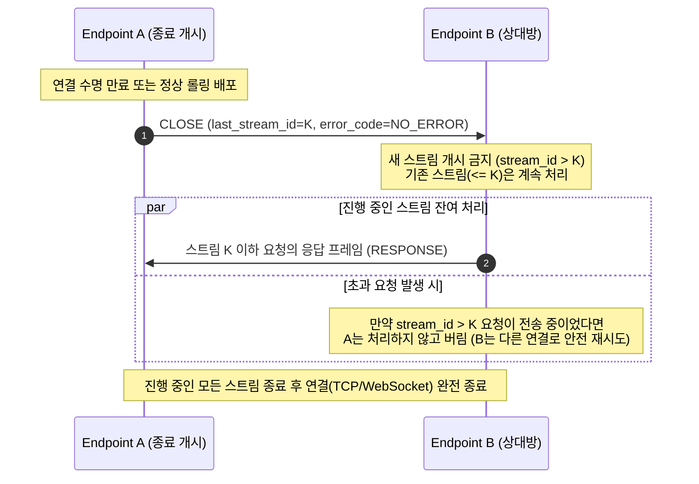
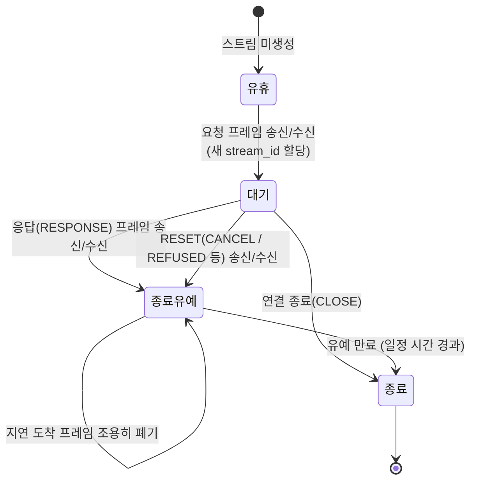
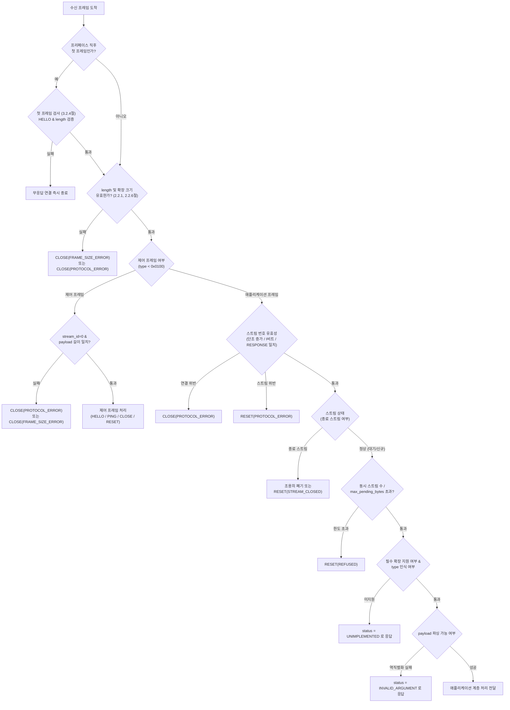

# Strand 규격

* **문서 상태 (Status)**: 초안 (Draft)
* **규격 버전 (Version)**: 0.0.1
* **작성일자 (Date)**: 2026-10-28
* **편집자 (Editor)**: 조정하 (@ppzxc)
* **저장소 (Repository)**: ppzxc/strand

---

## 1. 개요

Strand는 연결 하나로 여러 요청과 응답을 동시에 주고받기 위한 이진 메시지 프로토콜이다. 연결 안에서 요청 하나와 그 응답이 이루는 흐름을 가닥(strand)이라고 부르는데, 프로토콜 이름도 여기서 따왔다.

### 1.1 범위

이 문서는 연결을 맺는 절차, 프레임 형식, 제어 프레임, 파라미터 협상, 오류 처리, 배압, 그리고 연결을 유지하고 끝내는 방법을 다룬다. 반대로 메시지에 무엇을 담을지, 연결을 어떻게 보호할지(6절), 타이머를 몇 초로 둘지 같은 운영 문제는 다루지 않는다. 운영에 관한 권장값은 부록 A에 따로 모아 두었다.

통신 방식은 한 가지뿐이다. 한 스트림에서 요청이 하나 가고 응답이 하나 돌아온다. 요청은 클라이언트뿐 아니라 서버도 먼저 보낼 수 있다.

분할, 압축처럼 이번 버전에서 뺀 기능은 나중에 버전을 올리지 않고도 붙일 수 있도록 자리만 마련해 두었다. 자세한 내용은 부록 F에 있다.

### 1.2 공식 사용 환경

Strand 규격은 다음 두 가지를 동등한 공식 1급 사용 환경으로 정의한다.

1. **strand over TCP**:
   - 바이트 스트림 기반 사용 환경. 4바이트 `length` 필드를 읽어 프레임 경계를 구분한다.
   - 내부 마이크로서비스 간 고성능·저지연 통신에 권장된다.

2. **strand over WebSocket** [^RFC6455]:
   - 메시지 기반 사용 환경. 단일 WebSocket 바이너리 메시지(`Opcode 0x02`) 1개에 정확히 Strand 프레임 1개를 싣는다.
   - L7 로드밸런서, API 게이트웨이, 웹 브라우저 환경 통과에 권장된다.
   - 프레임 헤더(16바이트)와 payload 형식, 제어 프레임 및 상태 머신은 strand over TCP와 100% 동일하다.
   - 연결 수립 시 첫 번째 바이너리 메시지로 연결 서문(Connection Preface) 8바이트(3.1절)를 전송하고, 종료 시 Strand `CLOSE` 프레임 교환 후 WebSocket 정상 종료(`Close Frame 0x08`, `1000 Normal Closure`)를 수행한다.

### 1.3 용어

| 용어 (국문 / 영문) | 정의 |
| --- | --- |
| **엔드포인트 (Endpoint)** | 통신 연결의 한쪽 끝단. 물리적 연결을 주도하여 연 쪽을 **클라이언트 (Client)**, 연결을 수락한 쪽을 **서버 (Server)**로 정의 |
| **연결 서문 (Connection Preface)** | 클라이언트가 연결 수립 직후 단 1회 전송하는 8바이트 고정 식별자 (`C0 DE 53 54 52 30 00 00`) |
| **가닥 (Strand)** | 단일 연결 안에서 독립적으로 교환되는 하나의 요청과 그에 대한 단일 응답이 이루는 통신 단위 |
| **스트림 (Stream)** | 동일한 `stream_id`를 공유하는 요청 프레임과 응답 프레임의 논리적 쌍. 스트림당 1개 요청과 1개 응답만 허용 |
| **개시자 (Initiator)** | 특정 스트림의 요청 프레임을 먼저 전송하여 가닥(Strand)을 시작한 엔드포인트 (클라이언트 또는 서버) |
| **수신자 (Receiver)** | 개시자가 보낸 요청 프레임을 수신하여 처리하고 응답 프레임을 돌려주는 엔드포인트 |
| **프레임 (Frame)** | strand 전송의 기본 단위. 고정 16바이트 헤더, 가변 확장 영역, 가변 본문(payload)으로 구성 |
| **헤더 (Header)** | 모든 프레임 선두에 위치하는 16바이트 고정 크기 영역. 길이, 타입, 플래그, 스트림 식별자, 상태 코드 등을 수록 |
| **제어 프레임 (Control Frame)** | 연결 수명주기, 생존 확인, 정상 종료, 스트림 중단 등 세션 상태를 관리하는 프레임 (`type` < `0x0100`) |
| **애플리케이션 프레임 (Application Frame)** | 실제 비즈니스 서비스의 요청 및 응답 데이터를 운반하는 프레임 (`type` ≥ `0x0100`) |
| **확장 영역 (Extension Area)** | 헤더와 본문 사이에 위치하는 선택적 메타데이터 영역. TLV(`tag`, `length`, `value`) 구조로 인코딩 |
| **본문 (Payload)** | 프레임에 실리는 실제 데이터 바이트열. 제어 프레임은 고정 바이너리 형식을, 애플리케이션 프레임은 협상된 직렬화 포맷을 따름 |
| **기능 비트 (Capabilities Bitset)** | HELLO 프레임에서 교환하는 32비트 비트셋. 양 엔드포인트가 모두 켠 비트의 기능만 해당 연결에서 활성화 |
| **배압 (Backpressure)** | 수신자의 버퍼 용량을 초과하지 않도록 송신량을 제어하는 메커니즘. 소켓을 블로킹하지 않고 초과 시 즉시 오류 응답 거절 |
| **유예 상태 (Draining State)** | CLOSE 신호를 주고받아 새로운 스트림 요청 수락을 중단하고, 기 진행 중인 스트림들의 완료를 대기하는 상태 |

### 1.4 표기 규칙

- 연결 서문, 프레임 헤더, 확장 영역, 제어 프레임 payload에 들어가는 고정 길이 정수는 모두 big-endian, unsigned로 읽는다. 애플리케이션 payload는 협상한 형식의 인코딩 규칙을 따른다.
- 필드와 파라미터 이름은 `snake_case`, 프레임 타입·플래그·코드 상수는 `UPPER_SNAKE_CASE`로 쓴다.
- MUST, MUST NOT, SHOULD, SHOULD NOT, MAY는 대문자로 쓴 경우에만 요구 수준을 뜻한다 [^RFC2119] [^RFC8174].
- `0x`가 붙은 수는 16진수이고, KiB·MiB는 1,024의 배수다.

### 1.5 참조 표기

본 문서의 인용 표기는 IETF RFC 표준 관례의 영문 식별자 태그를 기반으로 한 GFM(GitHub Flavored Markdown) 표준 각주 표기법(예: [^RFC2119], [^RFC9113])을 사용하며, 클릭 시 해당 참고문헌으로 상호 이동한다.

참고문헌은 7절에서 **규범 참조(7.1절)** 와 **참고 참조(7.2절)** 로 엄격히 구분한다. 규범 참조는 규격을 구현할 때 반드시 따라야 하는 문서이고, 참고 참조는 설계 시 참고·비교한 배경 문서로 구현 자체에는 필수가 아니다.

---

## 2. 프레임 기초

### 2.1 기본 프레임 구조

프레임은 16바이트 고정 헤더 뒤에 확장 영역과 본문(payload)이 차례로 붙는 구조다. 헤더 필드는 모두 자기 크기의 배수가 되는 위치에서 시작하도록 배치했다.

```
 0                   1                   2                   3
 0 1 2 3 4 5 6 7 8 9 0 1 2 3 4 5 6 7 8 9 0 1 2 3 4 5 6 7 8 9 0 1
+---------------------------------------------------------------+
|                            length                             |  0
+-------------------------------+---------------+---------------+
|             type              |     flags     |    status     |  4
+-+-----------------------------+---------------+---------------+
|I|                         stream_id                           |  8
+-+-----------------------------+-------------------------------+
|       extensions_length       |           reserved            | 12
+-------------------------------+-------------------------------+
|              extensions (extensions_length 바이트)          ...  16
+---------------------------------------------------------------+
|              payload (나머지)                               ...
+---------------------------------------------------------------+
```

| 위치 | 크기 | 필드 |
| --- | --- | --- |
| 0 | 4 | `length` |
| 4 | 2 | `type` |
| 6 | 1 | `flags` |
| 7 | 1 | `status` |
| 8 | 4 | `stream_id` (최상위 비트 I 포함) |
| 12 | 2 | `extensions_length` |
| 14 | 2 | `reserved` |
| 16 | 가변 | `extensions` |
| 16 + `extensions_length` | 가변 | `payload` |

프레임 전체 크기는 4 + `length`이고, payload 크기는 `length`에서 12와 `extensions_length`를 뺀 값이다. 확장 영역과 본문이 모두 비면 16바이트가 되는데, 이것이 가장 작은 프레임이다. 이 버전에서는 프레임 하나가 곧 메시지 하나다. 메시지를 여러 프레임으로 쪼개는 규칙은 아직 없다.

헤더에 남긴 필드는 비교한 프로토콜 대부분이 프레임마다 싣는 길이, 종류, 상관 번호가 중심이다. 프로토콜 식별, 버전, 직렬화 형식처럼 연결이 유지되는 동안 바뀌지 않는 정보는 프레임마다 반복하지 않고 연결을 맺을 때 한 번만 주고받는다. 선정 근거는 부록 D에 정리했다.

### 2.2 헤더 필드

#### 2.2.1 length (4바이트)

이 필드 바로 뒤부터 프레임 끝까지의 바이트 수다. 최솟값은 12이고, 최댓값은 받는 쪽이 HELLO로 알린 `max_frame_size`에서 4를 뺀 값이다. 범위를 벗어난 프레임이 오면 `CLOSE(FRAME_SIZE_ERROR)`를 보내고 연결을 닫는다(MUST).

#### 2.2.2 type (2바이트)

프레임 종류를 나타낸다. `0x0000`부터 `0x00FF`까지는 제어 프레임(3절 및 4절), `0x0100`부터 `0xFFFF`까지는 애플리케이션 프레임에 쓴다(4.1절). 응답 프레임에는 요청과 같은 `type` 값을 넣는다(MUST).

#### 2.2.3 flags (1바이트)

2.3절에서 따로 설명한다.

#### 2.2.4 status (1바이트)

애플리케이션 요청을 처리한 결과다. 값의 의미는 2.5.1절에 있다. 이 필드는 애플리케이션 응답에서만 의미가 있으므로, 그 밖의 프레임에서는 0으로 보내고 받는 쪽은 값을 보지 않는다(MUST).

#### 2.2.5 stream\_id (4바이트)

가장 앞의 1비트(I)는 이 스트림을 누가 열었는지를 나타낸다. 0이면 클라이언트, 1이면 서버다. 나머지 31비트가 일련번호다. 이렇게 나눠 두면 양쪽이 동시에 요청을 보내도 번호가 겹치지 않고, RESET이나 CLOSE가 어느 스트림을 가리키는지도 헷갈리지 않는다.

0번은 연결 전체를 다루는 제어 프레임 전용이다. 새 스트림을 열 때는 자기 번호 공간에서 1부터 시작해 매번 이전보다 큰 번호를 쓴다(MUST). 3.5절에서 설명하는 CLOSE의 보장이 바로 이 성질에 기대고 있다. 번호를 다 쓰면 CLOSE를 보내고 새 연결을 맺으면 된다.

스트림 번호는 같은 연결 안에서만 유일하다. 연결이 바뀌어도 같은 요청임을 알아봐야 할 때는 `idempotency-key` 확장(2.4절)을 쓴다.

현재 버전에서는 스트림당 단 1개의 요청과 1개의 응답만 오가지만, 향후 기능 비트를 통한 메시지 분할 및 스트리밍 확장(부록 F) 시 동일한 식별자 위에서 복수 프레임이 흐를 수 있도록 업계 표준 관례(HTTP/2, QUIC, RSocket)를 따라 `stream_id`로 명명했다.

#### 2.2.6 extensions\_length (2바이트)

확장 영역의 바이트 수다. 0이면 확장 영역이 없다는 뜻이다. `length` − 12나 8,192를 넘으면 오류로 처리한다.

#### 2.2.7 reserved (2바이트)

항상 0으로 보내고, 받은 값은 무시한다(MUST).

### 2.3 플래그

| 비트 | 애플리케이션 프레임 | 제어 프레임 | 의미 |
| --- | --- | --- | --- |
| `0x01` | `RESPONSE` | `ACK` | 응답 프레임임을 표시. 제어 프레임에서는 HELLO·PING에 대한 확인 |
| `0x02` | `END` | — | 메시지의 마지막 프레임. 이 버전에서는 항상 1 |
| `0x04`\~`0x80` | — | — | 예약. 0으로 보내고 받을 때는 무시 |

#### 2.3.1 RESPONSE

응답인지 아닌지는 사실 개시자 비트(I)만 봐도 알 수 있다. 그런데도 `RESPONSE`를 따로 둔 것은 로그나 패킷 캡처처럼 연결 방향을 모르는 상황에서도 프레임 하나만 보고 요청과 응답을 가릴 수 있게 하려는 것이다. 정보가 중복되는 만큼 두 값은 항상 맞아떨어져야 한다.

| 받은 프레임 (애플리케이션) | 판단 |
| --- | --- |
| 내가 연 스트림, `RESPONSE` 있음 | 내 요청에 대한 응답 |
| 상대가 연 스트림, `RESPONSE` 없음 | 상대의 새 요청 |
| 내가 연 스트림, `RESPONSE` 없음 | 오류: `RESET(PROTOCOL_ERROR)` |
| 상대가 연 스트림, `RESPONSE` 있음 | 오류: `RESET(PROTOCOL_ERROR)` |

#### 2.3.2 END

이 버전에서는 모든 애플리케이션 프레임에 `END`를 1로 설정한다(MUST). 0인 프레임을 받으면 `RESET(PROTOCOL_ERROR)`으로 처리한다. 지금은 쓸모가 없어 보이지만, 나중에 메시지 분할을 넣을 때를 대비해 자리를 잡아 둔 비트다. 분할은 양쪽이 해당 기능 비트를 켠 연결에서만 쓸 수 있다(부록 F).

#### 2.3.3 제어 프레임의 플래그

제어 프레임에는 `ACK` 말고 다른 플래그를 쓰지 않는다(MUST NOT). `ACK`도 HELLO와 PING에서만 의미가 있다.

### 2.4 확장 영역

확장 영역은 요청에 덧붙이는 부가 정보를 담는 곳이다. 항목마다 자기 길이를 들고 있어서, 받는 쪽은 모르는 항목을 그냥 건너뛰면 된다. 덕분에 새 항목을 추가해도 이전 버전 구현과 문제없이 섞어 쓸 수 있다.

#### 2.4.1 항목 형식

```
+-------------------------------+-------------------------------+
|              tag              |            length             |
+-------------------------------+-------------------------------+
|                     value (length 바이트)                  ...
+---------------------------------------------------------------+
```

항목 사이에는 패딩이 없다. 각 항목의 (4 + `length`)를 모두 더한 값은 `extensions_length`와 정확히 같아야 한다(MUST). 한 프레임에 같은 `tag`를 두 번 쓸 수 없고, 항목은 64개까지 둘 수 있다.

#### 2.4.2 tag 범위

| 범위 | 분류 | 모르는 tag를 받았을 때 |
| --- | --- | --- |
| `0x0000`, `0xFFFF` | 금지 | 프로토콜 오류 |
| `0x0001`\~`0x7FFF` | 선택 | 건너뛴다 |
| `0x8000`\~`0xFFFE` | 필수 | 그 요청을 `status` = `UNIMPLEMENTED`로 거절한다 |

필수 범위는 받는 쪽이 이해하지 못하면 요청을 제대로 처리할 수 없는 항목을 위해 남겨 둔 것이다. 이 버전에는 아직 필수 항목이 없다.

#### 2.4.3 정의된 항목

| tag | 이름 | 값 | 의미 |
| --- | --- | --- | --- |
| `0x0001` | `timeout` | u32, 밀리초 | 요청 후 이 시간이 지나면 호출자는 결과를 기다리지 않는다 |
| `0x0002` | `traceparent` | ASCII 문자열 | 분산 추적 문맥 [^W3C-TRACE-CONTEXT] |
| `0x0003` | `idempotency-key` | 바이트열, 1\~64바이트 | 같은 요청의 재전송을 식별하는 키 [^IDEMPOTENCY-KEY] |

`timeout`은 요청을 받은 시점부터 센다. 장비마다 시계가 다를 수 있어서 절대 시각은 쓰지 않는다. 시간이 다 되면 받는 쪽은 처리를 멈추고 `DEADLINE_EXCEEDED`로 응답하는 것이 좋다(SHOULD).

확장 항목은 요청에만 붙이고, 응답의 확장 영역은 비워 둔다(SHOULD).

### 2.5 코드 체계

코드는 두 종류다. 요청을 처리한 결과는 응답 헤더의 `status`에 담고, 연결이나 스트림을 끊는 이유는 CLOSE·RESET의 `error_code`에 담는다.

#### 2.5.1 status (애플리케이션 결과)

`status`에는 여러 RPC 시스템이 함께 쓰는 상태 코드 체계를 그대로 가져왔다 [^GOOGLE-RPC].

| 값 | 이름 | 쓰임새 |
| --- | --- | --- |
| 0 | `OK` | 성공 |
| 1 | `CANCELLED` | 호출자가 취소함 |
| 2 | `UNKNOWN` | 분류되지 않는 오류 |
| 3 | `INVALID_ARGUMENT` | 요청 값이 잘못됨. payload를 해석할 수 없음 |
| 4 | `DEADLINE_EXCEEDED` | `timeout` 초과 |
| 5 | `NOT_FOUND` | 대상이 없음 |
| 6 | `ALREADY_EXISTS` | 이미 존재함 |
| 7 | `PERMISSION_DENIED` | 신원은 확인됐으나 권한이 없음 |
| 8 | `RESOURCE_EXHAUSTED` | 한도·할당량 초과 |
| 9 | `FAILED_PRECONDITION` | 현재 상태에서는 수행할 수 없음 |
| 10 | `ABORTED` | 동시 작업과 충돌 |
| 11 | `OUT_OF_RANGE` | 범위를 벗어난 값 |
| 12 | `UNIMPLEMENTED` | 모르는 `type`, 모르는 필수 확장 |
| 13 | `INTERNAL` | 내부 오류 |
| 14 | `UNAVAILABLE` | 일시적으로 처리할 수 없음. 재시도 가능 |
| 15 | `DATA_LOSS` | 복구할 수 없는 데이터 손실 |
| 16 | `UNAUTHENTICATED` | 신원을 확인할 수 없음 |
| 17\~255 | 예약 | 받으면 `UNKNOWN`으로 취급 |

`status`가 `OK`가 아닌 응답의 payload는 비워 두거나, 협상한 형식으로 인코딩한 오류 상세 메시지(`google.rpc.Status`)를 넣는다(MUST) [^GOOGLE-RPC]. 이때 메시지 안의 코드는 헤더의 `status`와 같아야 한다(MUST). 프로토콜 계층은 이 payload를 해석하지 않고 그대로 넘긴다.

#### 2.5.2 error\_code (세션/스트림 중단 사유)

| 값 | 이름 | 쓰임새 |
| --- | --- | --- |
| 0 | `NO_ERROR` | 정상 종료 |
| 1 | `PROTOCOL_ERROR` | 이 문서의 규칙 위반 |
| 2 | `INTERNAL_ERROR` | 엔드포인트 내부 오류 |
| 3 | `FRAME_SIZE_ERROR` | 프레임 또는 제어 payload 크기가 맞지 않음 |
| 4 | `HELLO_TIMEOUT` | HELLO에 대한 `ACK`가 오지 않음 |
| 5 | `STREAM_CLOSED` | 이미 끝난 스트림에 프레임이 옴 |
| 6 | `REFUSED` | 처리를 시작하지 않고 거절함. 다시 보내도 안전 |
| 7 | `CANCEL` | 스트림을 더 이상 처리하지 않음 |
| 8 | `OVERLOAD` | 과부하 또는 과도한 사용 |
| 9\~ | 예약 | 받으면 `INTERNAL_ERROR`로 취급 |

---

## 3. 연결 수명주기

Strand는 두 엔드포인트 사이에 순서가 보장되는 양방향 전송 채널이 열린 뒤부터 시작한다. 채널을 보호하는 방법은 6절을 참고한다.

### 3.1 연결 서문 (Connection Preface)

연결이 열리면 클라이언트는 무엇보다 먼저 아래 8바이트 연결 서문(Connection Preface)을 보낸다(MUST). strand over WebSocket에서는 이를 첫 번째 바이너리 메시지로 보낸다.

```
C0 DE 53 54 52 30 00 00
└─┬─┘ └────┬────┘ └─┬─┘
 식별값  "STR0"     예약(0)
```

서버는 앞 6바이트가 이 값과 다르면 아무 응답 없이 연결을 끊는다(MUST). 마지막 2바이트는 예약 영역이라 0으로 보내고, 받는 쪽에서는 보지 않는다.

`"STR0"`의 `0`이 이 프로토콜의 메이저 버전이다. 버전 번호는 여기 한 곳에만 있고, 값이 다르면 서로 통신할 수 없다. 같은 버전 안에서 기능을 늘릴 때는 버전을 올리는 대신 기능 비트(3.2절)를 쓴다.

첫 바이트를 `0xC0`으로 정한 것은 ASCII 범위 밖이기 때문이다. 같은 포트로 HTTP 요청이 잘못 들어와도 첫 바이트만 보고 바로 구분할 수 있다. 다만 연결 서문은 엉뚱한 상대를 걸러내는 용도일 뿐 보안 장치는 아니다.

서버는 연결 서문을 보내지 않고, 첫 바이트(또는 첫 바이너리 메시지)부터 HELLO 프레임을 보낸다.

연결 서문의 역사적 기원, 4대 설계 목적, 업계 표준·리더 비교, 8바이트 워드 정렬 및 식별자 충돌 분석에 대한 상세한 설계 근거는 부록 D.3을 참고한다.

### 3.2 HELLO 및 파라미터 협상

HELLO는 연결마다 한 번, 내가 받을 수 있는 한도와 지원하는 기능을 상대에게 알리는 프레임이다. 제어 프레임의 payload는 외부 직렬화 라이브러리 없이 읽을 수 있도록 고정된 바이너리 형식을 사용한다.

* **type**: `0x0001`
* **stream_id**: `0`
* **payload**: `(identifier u16, value u32)`의 반복. 확인은 `ACK` 플래그 + 빈 payload (길이 0).

#### 3.2.1 파라미터 정의

| identifier | 이름 | 기본값 | 보내는 쪽 | 의미 |
| --- | --- | --- | --- | --- |
| `0x0001` | `max_frame_size` | 4,194,304 (4 MiB) | 양쪽 | 받을 수 있는 프레임의 최대 크기. 곧 메시지 최대 크기. 허용 범위 16 KiB\~16 MiB |
| `0x0002` | `max_pending_bytes` | 16,777,216 (16 MiB) | 양쪽 | 아직 응답하지 않은 요청의 바이트 합계 한도(4.5절) |
| `0x0003` | `max_concurrent_streams` | 100 | 양쪽 | 상대가 동시에 열 수 있는 스트림 수 |
| `0x0004` | `capabilities` | 0 | 양쪽 | 기능 비트셋. 이 버전에서는 모든 비트가 예약 |
| `0x0005` | `content_types` | `0x00000002` | 클라이언트 | 지원하는 payload 형식. 비트 *n*이 형식 코드 *n* (0-indexed LSB: `1 << n`) |
| `0x0006` | `content_type` | 1 | 서버 | 서버가 고른 payload 형식 코드 |

#### 3.2.2 payload 형식 코드

| 코드 | 형식 |
| --- | --- |
| 0 | 예약 |
| 1 | Protocol Buffers 이진 인코딩 [^PROTOBUF-ENCODING] |
| 2 | Protocol Buffers JSON 매핑 [^PROTOJSON] |
| 3\~31 | 예약 |

#### 3.2.3 협상 규칙

모르는 identifier는 무시한다(MUST). 같은 identifier가 두 번 나오면 뒤의 값을 쓴다.

`max_*` 값은 보낸 쪽이 받아들일 수 있는 한도다. 그러니 각 엔드포인트는 상대가 알려 준 한도를 넘지 않게 보내야 한다(MUST). 또 `max_frame_size`는 `max_pending_bytes`보다 클 수 없으며(MUST), 이를 어기면 `CLOSE(PROTOCOL_ERROR)`로 끊는다.

연결에서 실제로 쓸 수 있는 기능은 양쪽 `capabilities`에 공통으로 켜진 비트뿐이다.

payload 형식은 서버가 정한다. 서버는 클라이언트의 `content_types` 가운데 하나를 골라 `content_type`으로 알려 주고, 고를 것이 없으면 `CLOSE(PROTOCOL_ERROR)`로 끊는다. 그 뒤로 연결의 애플리케이션 payload는 모두 이 형식을 따른다.

HELLO는 연결 도중에 다시 보내지 않는다. 값을 바꾸고 싶으면 새 연결을 맺는다.

#### 3.2.4 첫 프레임 검사

서버는 프리페이스 다음에 오는 첫 프레임의 헤더만 읽은 상태에서, payload를 읽기 전에 아래를 확인한다(MUST). 하나라도 어긋나면 아무것도 보내지 않고 연결을 닫는다.

1. `type`이 `0x0001`(HELLO)인가
2. `stream_id`와 `flags`가 모두 0인가
3. `length`가 12 + 6 × 64 이하인가. 협상이 끝나기 전에 큰 버퍼를 잡지 않게 하는 제한이다.

### 3.3 수립 순서

1. 클라이언트가 프리페이스를 보내고 곧바로 HELLO를 이어 보낸다.
2. 서버는 프리페이스와 첫 프레임을 3.2.4절 기준으로 확인한다. 문제가 없으면 자기 HELLO를 보내고, 클라이언트 HELLO에 `ACK`로 답한다.
3. 클라이언트도 서버 HELLO에 `ACK`로 답한다.
4. 상대의 HELLO를 받은 뒤부터는 애플리케이션 프레임을 보낼 수 있다. 클라이언트는 기본값 범위를 넘지 않는다면 서버 HELLO를 기다리지 않고 먼저 보내도 된다(MAY).
5. HELLO를 보내고 정해 둔 시간 안에 `ACK`가 오지 않으면 `CLOSE(HELLO_TIMEOUT)`을 보내고 연결을 닫는다.



프리페이스 다음에 설정 프레임을 주고받는 흐름은 HTTP/2의 연결 시작 방식을 참고했다 [^RFC9113].

### 3.4 생존 확인: PING

PING은 어느 쪽이든 보낼 수 있다.
* **type**: `0x0002`
* **stream_id**: `0`
* **payload**: 정확히 8바이트 (임의의 바이트열)

받은 쪽은 같은 8바이트에 `ACK` 플래그(`flags = 0x01`)를 붙여 즉시 돌려준다(MUST). payload 길이가 정확히 8바이트가 아니면 `CLOSE(FRAME_SIZE_ERROR)`로 처리한다. 일정 시간 안에 답이 없으면 연결이 끊긴 것으로 보고 닫는다.

서버는 한동안 아무 프레임도 오지 않는 연결을 `CLOSE(NO_ERROR)`로 정리해도 된다(MAY). PING이 지나치게 자주 오면 `CLOSE(OVERLOAD)`로 끊을 수도 있다(MAY).

### 3.5 연결 종료: CLOSE

CLOSE는 연결 전체의 종료를 알리는 프레임이다.
* **type**: `0x0003`
* **stream_id**: `0`
* **payload**: `last_stream_id` u32 (4B) + `error_code` u32 (4B) + `reason` 가변 (UTF-8 문자열, 0B 이상)

```
CLOSE payload
+-----------------------------+
|      last_stream_id (32)    |
+-----------------------------+
|        error_code (32)      |
+-----------------------------+
|      reason (가변, UTF-8) ...
+-----------------------------+
```

payload 길이가 8바이트 미만이면 `CLOSE(FRAME_SIZE_ERROR)`로 처리한다. `reason`은 사람이 읽으라고 넣는 설명이며, 프로그램 동작이 이 값에 기대서는 안 된다.

CLOSE를 보내는 쪽은 `last_stream_id`에 상대가 연 스트림 가운데 이미 처리했거나 앞으로 처리할 가장 큰 번호를 적는다. CLOSE를 받은 쪽은 그 연결에서 새 스트림을 열지 않는다(MUST).

`last_stream_id`보다 큰 번호로 보낸 요청은 처리되지 않았다는 것이 보장된다. 그래서 다른 연결로 다시 보내도 중복될 걱정이 없다.

`error_code`가 `NO_ERROR`이면 정상 종료다. 진행 중인 스트림을 마저 끝낸 뒤 연결을 닫는다. 다른 코드라면 오류로 인한 종료이므로 바로 닫아도 된다.



---

## 4. 스트림 및 애플리케이션 통신

### 4.1 애플리케이션 프레임

애플리케이션 프레임의 `type`은 `0x0100` 이상의 값으로, 서비스 정의(`.proto`)의 메서드마다 하나씩 붙인다. payload에는 HELLO에서 정한 형식(3.2.2절)으로 만든 요청이나 응답 메시지가 들어간다.

모르는 `type`으로 요청이 오면 연결은 그대로 두고 `status` = `UNIMPLEMENTED`로 답한다(MUST). 메시지 형식을 호환되지 않게 바꿔야 할 때는 기존 `type`을 고치지 말고 새 번호를 받는다.

```protobuf
syntax = "proto3";
package strand.v1;

import "google/protobuf/descriptor.proto";

extend google.protobuf.MethodOptions {
  uint32 type_code = 50001;   // 50000~99999는 내부 용도용 옵션 번호
}

service MessageService {
  rpc Send(SendRequest) returns (SendResponse) { option (type_code) = 0x0101; }
  rpc Query(QueryRequest) returns (QueryResponse) { option (type_code) = 0x0102; }
}
```

### 4.2 스트림 다중화 및 식별

새 스트림을 열 때는 자기 번호 공간에서 1부터 시작해 매번 이전보다 큰 번호를 쓴다(MUST).
* **클라이언트 개시 스트림**: 최상위 비트 I = 0 (`stream_id` = 1, 2, 3...)
* **서버 개시 스트림**: 최상위 비트 I = 1 (`stream_id` = `0x80000001`, `0x80000002`...)

애플리케이션 프레임은 `RESPONSE` 플래그와 개시자 비트(I)가 일치해야 한다(2.3.1절). 일치하지 않거나 `END` 플래그가 1이 아닌 경우 해당 스트림을 `RESET(PROTOCOL_ERROR)`으로 처리한다.

### 4.3 스트림 생명주기 및 상태 머신

| 상태 | 들어가는 조건 | 나가는 조건 |
| --- | --- | --- |
| 대기 | 요청 프레임을 보냄(받음) | 응답 프레임 또는 RESET |
| 종료 | 응답 또는 RESET | — |



끝난 스트림에 프레임이 늦게 도착하면 잠깐 동안은 조용히 버린다. 취소(RESET)와 응답이 엇갈려 도착하는 일이 흔하기 때문이다.

### 4.4 스트림 중단: RESET

RESET은 스트림 하나를 그 자리에서 즉시 중단시키는 제어 프레임이다.
* **type**: `0x0004`
* **stream_id**: 중단 대상 스트림 번호 (0일 수 없음)
* **flags**: `0` (ACK 등 다른 플래그 사용 금지)
* **payload**: 정확히 4바이트 (`error_code` u32)

```
RESET payload
+-----------------------------+
|        error_code (32)      |
+-----------------------------+
```

payload 길이가 정확히 4바이트가 아니면 `CLOSE(FRAME_SIZE_ERROR)`로 처리한다.

요청한 쪽이 결과가 더는 필요 없을 때는 `RESET(CANCEL)`을 보낸다. 받은 쪽은 할 수 있으면 처리를 멈추고, 응답은 보내지 않는다.

### 4.5 배압 (Backpressure)

배압은 응답을 신호로 삼는다. 각 엔드포인트는 보냈지만 아직 응답을 받지 못한 요청의 바이트 합을 상대의 `max_pending_bytes` 아래로 유지한다(SHOULD). 응답이 돌아오면 그만큼 다시 보낼 수 있다. 응답이 곧 "더 보내도 된다"는 신호인 셈이다.

받는 쪽에서는 아직 응답하지 않은 요청의 바이트 합이 자신의 `max_pending_bytes`를 넘으면, 새로 들어오는 요청을 `RESET(REFUSED)`으로 돌려보낸다.

이때 소켓 읽기를 멈춰서는 안 된다(MUST NOT). 읽기를 멈추면 PING, CLOSE, RESET까지 같이 막혀서 상대는 연결이 죽었다고 판단하게 된다.

### 4.6 다시 보내기 (Retry)

연결이 끊겨 응답을 받지 못한 요청은 새 연결로 다시 보낼 수 있다. CLOSE의 `last_stream_id`보다 큰 번호의 요청은 처리되지 않은 것이 확실하므로(3.5절) 그대로 다시 보내면 된다.

나머지 요청은 처리됐는지 알 방법이 없다. 한 번만 처리돼야 하는 요청이라면 `idempotency-key`를 붙여 보낸다(SHOULD). 같은 키로 다시 온 요청을 어떻게 다룰지는 애플리케이션이 정한다(부록 A.4).

---

## 5. 수신 프레임 검사 및 오류 처리

오류는 영향을 받는 범위가 가장 좁은 단위에서 처리한다. 요청 하나의 문제면 `status`로 응답하고, 스트림 하나의 문제면 RESET으로 그 스트림만 끊는다. CLOSE로 연결 전체를 닫는 것은 프레임 경계를 더는 믿을 수 없을 때뿐이다.

제어 프레임 타입 중 `0x0005`\~`0x00FF`는 예약된 타입으로, 수신 시 무시한다(MUST).

### 5.1 검사 순서

| 순서 | 검사 | 실패 시 |
| --- | --- | --- |
| 1 | 프리페이스(3.1절) | 아무것도 보내지 않고 닫음 |
| 2 | 첫 프레임(3.2.4절) | 아무것도 보내지 않고 닫음 |
| 3 | `length` 범위(2.2.1절) | `CLOSE(FRAME_SIZE_ERROR)` |
| 4 | 확장 영역 길이·형식(2.2.6절, 2.4절) | `CLOSE(PROTOCOL_ERROR)` |
| 5 | 제어 프레임의 `stream_id`가 0 (RESET 제외), payload 크기 | `CLOSE(PROTOCOL_ERROR)` 또는 `CLOSE(FRAME_SIZE_ERROR)` |
| 6 | 새 스트림의 번호가 0이 아니고, 개시자 비트가 맞고, 이전보다 큼 | `CLOSE(PROTOCOL_ERROR)` |
| 7 | `RESPONSE`와 개시자 비트 일치, `END` = 1 (애플리케이션 프레임) | `RESET(PROTOCOL_ERROR)` |
| 8 | 끝난 스트림이 아님 | `RESET(STREAM_CLOSED)` |
| 9 | 동시 스트림 수, 미응답 바이트 한도(4.5절) | `RESET(REFUSED)` |
| 10 | 모르는 필수 확장, 모르는 `type` | `status` = `UNIMPLEMENTED` |
| 11 | payload를 협상된 형식으로 해석 가능 | `status` = `INVALID_ARGUMENT` |

1번에서 6번까지는 연결을 닫고, 7번에서 9번까지는 해당 스트림만, 10번과 11번은 해당 요청만 실패로 처리한다.



---

## 6. 보안 고려사항

### 6.1 보호 수단 없음

Strand 자체에는 기밀성, 무결성, 상대 인증 기능이 없다. 헤더와 payload는 바이트 스트림에 그대로 실린다. 그러니 신뢰할 수 없는 네트워크를 지나는 환경이라면 이런 보호를 제공하는 채널 위에서 Strand를 써야 한다(SHOULD). 상호 인증을 켠 TLS 1.3이 가장 흔한 선택이다 [^RFC8446].

### 6.2 멱등 키

멱등 키는 클라이언트가 정하기 때문에 서로 다른 클라이언트의 키가 우연히 같을 수 있다. 받는 쪽이 키만 보고 중복을 판단하면, 어떤 클라이언트의 요청이 처리되지 않고 넘어가거나 다른 클라이언트의 처리 결과가 엉뚱한 곳으로 나갈 수 있다. 그래서 애플리케이션은 키를 인증된 상대별로 나눠서 관리해야 한다.

### 6.3 자원 소모

받는 쪽은 HELLO로 알린 한도(`max_frame_size`, `max_pending_bytes`, `max_concurrent_streams`)와 확장 영역 한도를 넘는 입력을 받아들이지 않는다. 협상이 끝나기 전에는 첫 프레임 크기를 제한해(3.2.4절) 큰 버퍼를 잡지 않는다.

모르는 것은 무시하라는 규칙(예약 타입, 예약 플래그, 모르는 확장 항목)을 악용한 쓸데없는 트래픽이나 지나치게 잦은 PING은 `CLOSE(OVERLOAD)`로 끊을 수 있다.

### 6.4 사람이 읽는 문자열

CLOSE의 `reason`과 오류 상세 메시지는 상대에게 그대로 전달된다. 내부 경로, 스택 트레이스, 인증 정보 같은 민감한 내용은 넣지 않는다.

---

## 7. 참고문헌

### 7.1 규범 참조

구현할 때 반드시 필요한 문서다.

[^RFC2119]: RFC 2119, *Key words for use in RFCs to Indicate Requirement Levels*
[^RFC8174]: RFC 8174, *Ambiguity of Uppercase vs Lowercase in RFC 2119 Key Words*
[^PROTOBUF-ENCODING]: Protocol Buffers, *Encoding*
[^PROTOJSON]: Protocol Buffers, *ProtoJSON Format*
[^GOOGLE-RPC]: googleapis, `google/rpc/code.proto`, `google/rpc/status.proto`
[^W3C-TRACE-CONTEXT]: W3C, *Trace Context*

### 7.2 참고 참조

설계할 때 참고하거나 비교한 문서로, 구현에는 필요하지 않다.

[^RFC9113]: RFC 9113, *HTTP/2*
[^GRPC-HTTP2]: gRPC, *gRPC over HTTP2*
[^GRPC-KEEPALIVE]: gRPC, *Keepalive*, *Connection Backoff Protocol*
[^RFC9000]: RFC 9000, *QUIC*
[^FINAGLE-MUX]: Twitter Finagle, *Mux* 프로토콜
[^DUBBO2]: Apache Dubbo, *Dubbo2 TCP Protocol*
[^SOFABOLT]: Ant Group, *SOFABolt* 프로토콜
[^THRIFT-THEADER]: Apache Thrift, *THeader Format*
[^KAFKA-PROTOCOL]: Apache Kafka, *Protocol Guide*, KIP-482
[^RFC6455]: RFC 6455, *The WebSocket Protocol*
[^RESP3]: Redis, *RESP3* (`HELLO`)
[^IDEMPOTENCY-KEY]: IETF HTTPAPI, *The Idempotency-Key HTTP Header Field* (초안)
[^MEMCACHED-BINARY]: Memcached, *Binary Protocol*
[^SBE]: Real Logic, *Simple Binary Encoding*
[^RFC8446]: RFC 8446, *The Transport Layer Security (TLS) Protocol Version 1.3*

---

## 부록 A. 운영 가이드 (비규범)

여기 나오는 값은 권장값일 뿐 상호운용에는 영향을 주지 않는다. 배포 환경에 맞게 조정해도 된다.

### A.1 연결 유지

| 항목 | 권장값 | 설명 |
| --- | --- | --- |
| PING 주기 | 30초 | 마지막 수신 후 이 시간이 지나면 클라이언트가 PING. 경로상 장비의 유휴 차단 시간보다 짧게 |
| PING 응답 대기 | 10초 | 넘으면 연결 폐기 |
| 서버 유휴 한도 | 90초 | 이 시간 동안 수신이 없으면 `CLOSE(NO_ERROR)` |
| PING 최소 간격 | 10초 | 이보다 잦은 PING이 계속되면 `CLOSE(OVERLOAD)`. PING 주기보다 짧아야 함 |
| HELLO 확인 대기 | 5초 | 넘으면 `CLOSE(HELLO_TIMEOUT)` |

이 구성은 gRPC의 keepalive 운영 방식을 참고했다 [^GRPC-KEEPALIVE].

### A.2 재분배와 배포

서버는 연결마다 최대 수명(권장 30분, ±10% 무작위)을 정해 두고, 시간이 되면 `CLOSE(NO_ERROR)`를 보낸다. 이렇게 해 두면 노드를 늘렸을 때 기존 연결이 자연스럽게 새 노드로 퍼지고, 수명에 무작위 폭을 둔 덕분에 클라이언트가 한꺼번에 다시 접속하는 일도 막을 수 있다.

롤링 배포를 할 때는 내릴 노드가 모든 연결에 `CLOSE(NO_ERROR)`를 보내고, 진행 중인 스트림이 끝나거나 30초가 지나면 종료한다. 클라이언트는 CLOSE를 받으면 다른 노드와 새 연결을 먼저 맺은 다음 기존 연결을 놓는다.

### A.3 재연결

접속에 실패하면 대기 시간을 조금씩 늘려 가며 다시 시도한다. 처음 1초에서 시작해 1.6배씩 늘리고, ±20% 무작위 폭을 두며, 120초에서 멈춘다 [^GRPC-KEEPALIVE]. 서버가 재시작된 뒤 빨리 복구되는 것이 중요한 내부망 설치 환경이라면 최댓값을 30초 정도로 낮추는 편이 낫다.

### A.4 멱등 키 보관

멱등 키는 인증된 상대와 키의 쌍으로 구분한다(6.2절). 이미 처리한 쌍이 다시 오면 처리하지 않고 앞서 만든 결과를 그대로 돌려준다.

처리 기록은 클라이언트가 다시 보낼 수 있는 기간, 즉 재연결 최대 대기 시간에 요청 `timeout`을 더한 것보다 길게 보관한다. 서버가 여러 대라면 모든 노드가 같은 기록을 볼 수 있도록 공유 저장소를 쓴다.

---

## 부록 B. 구현 모듈 (비규범)

참조 구현은 저장소 하나에 여러 모듈을 두고 Java 8을 대상으로 한다. 프로토콜 코어는 네트워크 입출력도, 스레드도 직접 다루지 않는다. 바이트를 받으면 이벤트를 내놓고, 보내야 할 바이트를 돌려줄 뿐이다.

| 모듈 | 의존성 | 역할 |
| --- | --- | --- |
| `strand-core` | 없음 | 프리페이스·프레임·제어 프레임 처리, 스트림 상태, HELLO 협상, 5절 검사, 배압 계산 |
| `strand-netty` | core, Netty 4.1 | Netty 파이프라인 어댑터 |
| `strand-nio` | core | JDK `SSLEngine`과 NIO 전송 모듈 |
| `strand-protobuf` | core, protobuf-java, 공통 proto | 메시지 직렬화, `type_code` 매핑, 오류 상세 변환 |
| `strand-conformance` | core | 입력 바이트와 기대 결과로 이뤄진 적합성 벡터 검증 모듈. 배포하지 않음 |
| `strand-bom` | — | 모듈 버전 정렬 |

의존성은 늘 어댑터에서 `strand-core` 쪽으로만 흐른다. 빌드 단계에서 `strand-core`에 외부 의존성이 끼어들지 않았는지 검사한다. 각 JAR에는 `Automatic-Module-Name`(예: `io.github.ppzxc.strand.core`)을 넣고, 모든 모듈을 같은 버전으로 `io.github.ppzxc` 그룹 아래에 배포한다.

```java
// strand-netty 구성 예
pipeline
  .addLast("tls", sslContext.newHandler(ch.alloc()))
  .addLast("preface", new PrefaceHandler())   // 서버: 첫 8바이트 확인 후 제거
  .addLast("frame", new LengthFieldBasedFrameDecoder(
      maxFrameSize, 0, 4, 0, 0, true))        // length 필드 기준으로 프레임 분리
  .addLast("strand", new StrandChannelHandler(connection));
```

---

## 부록 C. 외부 어댑터 대응표 (비규범)

외부 시스템에 같은 서비스를 gRPC나 HTTP/JSON으로 열어 줘야 할 때 참고할 수 있는 대응표다.

| Strand | gRPC [^GRPC-HTTP2] | HTTP/JSON |
| --- | --- | --- |
| 애플리케이션 `type` | `:path` (`/<패키지>.<서비스>/<메서드>`) | `POST /<패키지>.<서비스>/<메서드>` |
| `stream_id` | HTTP/2 스트림 번호 | 요청 단위 |
| `status` | `grpc-status` | HTTP 상태 코드 (Google API 관행 대응) |
| 오류 상세 | `grpc-status-details-bin` | 응답 본문 |
| `timeout` | `grpc-timeout` | `Request-Timeout` (사설 헤더) |
| `traceparent` | `traceparent` | `traceparent` |
| `idempotency-key` | `idempotency-key` 메타데이터 | `Idempotency-Key` [^IDEMPOTENCY-KEY] |
| `content_type` 1 / 2 | `application/grpc+proto` / `+json` | `application/x-protobuf` / `application/json` |
| HELLO | SETTINGS | — |
| PING | PING | — |
| CLOSE | GOAWAY | — |
| RESET | RST\_STREAM | — |
| `error_code` 6 `REFUSED` / 8 `OVERLOAD` | REFUSED\_STREAM / ENHANCE\_YOUR\_CALM | — |
| 인증된 엔드포인트 | mTLS 피어 인증서 | mTLS 또는 토큰 |

---

## 부록 D. 설계 근거 (비규범)

### D.1 헤더 필드 선정

비교한 10개 프로토콜의 고정 헤더를 놓고, 각 필드를 프레임마다 싣는 경우가 얼마나 되는지 세어 봤다. 헤더에는 대부분이 싣는 필드만 남겼다 [^RFC9113] [^GRPC-HTTP2] [^FINAGLE-MUX] [^DUBBO2] [^SOFABOLT] [^THRIFT-THEADER] [^KAFKA-PROTOCOL] [^MEMCACHED-BINARY] [^SBE].

| 필드 | 빈도 | Strand에서의 위치 |
| --- | --- | --- |
| 길이 | 9/10 | 헤더 `length` |
| 메시지 종류 | 8/10 | 헤더 `type` |
| 상관 번호 | 7/10 | 헤더 `stream_id` |
| 플래그 | 5/10 | 헤더 `flags` |
| 확장 영역 | 5/10 | 헤더 `extensions_length` + TLV |
| 응답 상태 | 4/10 (대부분 응답 전용) | 헤더 `status` (응답에서만 의미) |
| 프레임마다의 식별값 | 4/10 | 프리페이스로 1회 |
| 메시지마다의 직렬화 형식 | 4/10 | HELLO로 1회 |
| 프레임마다의 버전 | 3/10 | 프리페이스 + 기능 비트 |
| 고정 헤더의 제한 시간 | 1/10 | 확장 항목 `timeout` |
| 프레임 체크섬 | 1/10 | 없음 (하위 계층이 담당) |

### D.2 주요 장치의 출처

| 장치 | 착안한 곳 |
| --- | --- |
| 프리페이스 후 설정 교환 | HTTP/2 연결 시작 [^RFC9113] |
| 개시자별 번호 공간 | HTTP/2 스트림 번호 [^RFC9113], QUIC [^RFC9000] |
| 요청·응답 표시 비트 | Dubbo [^DUBBO2], SOFABolt [^SOFABOLT] |
| 길이를 가진 확장 항목 | Thrift THeader [^THRIFT-THEADER], Kafka tagged fields [^KAFKA-PROTOCOL], Memcached extras [^MEMCACHED-BINARY] |
| 연결 정리 종료와 생존 확인 | Finagle Mux [^FINAGLE-MUX], HTTP/2 [^RFC9113] |
| 모르는 항목 무시 규칙 | HTTP/2 [^RFC9113] |
| 연결 단위 기능 협상 | Kafka [^KAFKA-PROTOCOL], Redis HELLO [^RESP3] |
| 두 계층 코드 체계 | gRPC over HTTP/2 [^GRPC-HTTP2] |

### D.3 연결 서문(Connection Preface) 설계 근거

연결 서문은 연결 수립 직후 클라이언트가 보내는 8바이트(`C0 DE 53 54 52 30 00 00`) 식별자다. 본 절에서는 연결 서문의 역사적 맥락, 4대 핵심 목적, 업계 주요 프로토콜과의 구조 비교, 바이트 엔트로피 및 충돌 분석을 기록한다.

#### D.3.1 기원과 진화

1. **유닉스 매직 넘버 (1970년대)**: 초기 Unix 실행 파일(`a.out`) 헤더에서 출발한 매직 넘버 기법은 네트워크 프로토콜(Sun RPC, Java RMI 등)의 초기 식별자로 확장되었다.
2. **HTTP/2 Connection Preface (RFC 7540 / RFC 9113)**: IETF는 HTTP/2에서 'Connection Preface'라는 공식 용어를 채택했다 [^RFC9113]. HTTP/2는 24바이트 텍스트(`PRI * HTTP/2.0\r\n\r\nSM\r\n\r\n`)를 사용해 구형 HTTP/1.1 서버나 프록시가 이 연결을 받았을 때 오류(`400` 또는 `501`)를 내고 즉시 중단하도록 유도하는 Polyglot 기법을 도입했다.
3. **현대 바이너리 RPC**: 레거시 텍스트 프록시와의 호환성이 필요 없는 내부망 고성능 RPC 환경에서는 HTTP/2의 무거운 24바이트 텍스트 대신, CPU 워드 정렬에 최적화된 4~8바이트 순수 바이너리 서문으로 진화했다.

#### D.3.2 4대 설계 목적

1. **조기 실패 (Fail-Fast) 및 DoS 방어**: 연결 직후 6~8바이트만 읽고 지원하지 않는 상대임을 판별하여 즉시 연결을 종료한다. 비정상 연결에 거대한 수신 버퍼나 세션 상태를 할당하지 않으므로 자원 소모 공격을 방어한다.
2. **단일 포트 멀티프로토콜 분기 (Port Unification)**: 서버가 하나의 리스닝 소켓에서 여러 프로토콜(TLS, HTTP/1.1, Strand 등)을 서비스할 때, 첫 1~2바이트만 읽어 적절한 디코더 파이프라인으로 라우팅할 수 있다.
3. **교차 프로토콜 공격 방어 (Cross-Protocol Attack)**: 텍스트 기반 인젝션(HTTP 파이프라이닝, SMTP 릴레이 등)이 바이너리 RPC 상태 머신을 오염시키는 것을 첫 바이트 검사로 원천 차단한다.
4. **불변 메이저 버전 확정**: 프레임 헤더 크기나 직렬화 규칙 자체를 바꿀 수 있는 메이저 버전을 프레임 파서 진입 전에 0단계에서 단 1회 확정한다.

#### D.3.3 업계 주요 규격과의 구조 비교

| 프로토콜 | 서문 방식 | 크기 및 구조 | 평가 및 특징 |
| --- | --- | --- | --- |
| **HTTP/2** [^RFC9113] | 클라이언트 단방향 | 24바이트 텍스트 (`PRI * HTTP/2.0...`) | 레거시 HTTP/1.1 차단 목적의 Polyglot 트릭. RPC에는 과도하게 길고 무거움 |
| **QUIC** [^RFC9000] | 패킷 헤더 내재화 | 패킷당 4바이트 (Initial Long Header Version) | UDP 기반이므로 스트림 서문 대신 모든 Initial 패킷에 버전을 포함 |
| **Apache Dubbo** [^DUBBO2] | 프레임 헤더 매직 | 매 프레임마다 2바이트 (`0xDA 0xBB`) | 연결 단위 서문이 없고 매 프레임 대역폭을 낭비하는 2010년대 초기 방식 |
| **Ant Group SOFABolt** [^SOFABOLT] | 프레임 헤더 매직 | 매 프레임마다 1바이트 (`0x01` or `0x02`) | 프레임마다 프로토콜 코드를 중복 전송하는 구조 |
| **RSocket** | 첫 프레임 통합 | `SETUP` 프레임 헤더 내 32비트 버전 | 별도 프리페이스 없이 첫 제어 프레임이 서문 역할을 겸함 |
| **Strand** | 클라이언트 단방향 | 8바이트 바이너리 (`C0 DE 53 54 52 30 00 00`) | 64비트 워드 정렬, 프레임 매직 완전 제거, TCP/WebSocket 100% 동일 규정 |

#### D.3.4 바이트 구조와 충돌 검증

Strand의 서문 `C0 DE 53 54 52 30 00 00`은 다음 원칙으로 구성되었다:
- **`0xC0 0xDE` (식별값, 2바이트)**: 최상위 비트(MSB)가 1인 바이트(`0xC0` = `1100 0000`)로 시작하여, ASCII 인쇄 가능 문자(`0x20`~`0x7E`)를 사용하는 HTTP(`GET`, `POST`), Redis, SMTP 등의 텍스트 프로토콜 오접속을 첫 바이트에서 즉시 거절한다.
- **`53 54 52 30` = `"STR0"` (버전 확정, 4바이트)**: 패킷 분석 도구(Wireshark, tcpdump)나 헥스 덤프에서 프로토콜 이름과 메이저 버전 0을 사람이 즉시 판독할 수 있게 한다.
- **`00 00` (예약 영역, 2바이트)**: 64비트 정렬을 만족하며, 미래를 위해 0으로 예약된다.

**식별자 충돌 검증**:
`C0 DE` 자체는 과거 일부 OS 디버거(Amiga OS)나 펌웨어 블록 구분자 등 로컬 메모리 패턴에 쓰인 사례가 있으나, 전송 프로토콜의 와이어 헤더로는 표준에 존재하지 않는다. 나아가 Strand는 앞 6바이트 전체(`C0 DE 53 54 52 30`)를 함께 검증하므로 유효 엔트로피는 48비트(약 281조 분의 1)에 달한다. 따라서 TLS ClientHello(`0x16 0x03`), SSH(`SSH-`), SOCKS5(`0x05`) 및 공식 파일 시그니처 테이블과 바이트 시퀀스가 단 1건도 충돌하지 않는다.

#### D.3.5 64비트 워드 정렬과 성능

현대 64비트 CPU(x86_64, ARM64) 아키텍처에서 8바이트는 레지스터 1개 크기와 일치한다. Netty나 Java NIO 전송 모듈은 버퍼에서 바이트를 하나씩 검사할 필요 없이, 단 1회의 64비트 정수 비교(`buffer.readLong() == 0xC0DE535452300000L`)로 1 클럭 사이클(O(1)) 내에 서문 일치 여부를 검증할 수 있다.
또한 연결 시작 시 단 8바이트만 전송함으로써, 프레임마다 매직 넘버를 싣는 구형 RPC 대비 대규모 RPC 트래픽에서 유의미한 대역폭 절감 효과를 거둔다.

---

## 부록 E. 설계 결정 기록 (비규범)

| # | 결정 | 이유 | 대가 |
| --- | --- | --- | --- |
| 1 | 스트림당 요청 1개·응답 1개 | 스트리밍 요구 없음 | 필요 시 기능 비트로 추가 |
| 2 | 개시자 비트 + `RESPONSE` | 개시자 비트는 번호 충돌 방지에 필수. `RESPONSE`는 로그 판독성 | 중복 표시, 일치 검사 필요 |
| 3 | 버전은 서문 한 곳, 나머지는 기능 비트 | 식별은 해석 전에 해야 함. 버전 번호가 둘이면 혼동 | 마이너 버전 개념 없음 |
| 4 | 프레임 = 메시지, 기본 4 MiB | 분할 요구 없음 | 큰 메시지가 연결을 잠시 점유 |
| 5 | 보안·신원은 프로토콜 밖 | 바이트 스트림의 보호는 하위 계층, 신원 구분은 애플리케이션의 관심사. 보안 고려사항으로만 명시 | 배포마다 보안 채널 구성 필요 |
| 6 | 타이머·저장소는 부록 A | 명세는 주고받는 것만 다룸 | 구현 간 수치 차이 가능 |
| 7 | 오류 상세는 `google.rpc.Status` | `status` 체계와 짝 [^GOOGLE-RPC] | 상위 모듈에 공통 proto 의존 |
| 8 | 식별자는 `ppzxc` 이름 공간 | 프로토콜은 구현 소유자 기준 | 미등록 사설 식별자 |
| 9 | 읽기를 멈추지 않는 배압, 응답 = 크레딧 반환 | 읽기를 멈추면 제어 프레임까지 막힘 | 거절된 요청은 읽고 버림 |
| 10 | 프로토콜 이름 Strand, 메이저 0 | 기존 codec과 별개 | 식별자 전체 교체 |
| 11 | 제어 프레임·HELLO는 고정 바이너리 | 코어 모듈 의존성 0 | HELLO에 문자열 값 불가, 코드표 관리 |
| 12 | Java 8, 단일 저장소 여러 모듈 | 설치형 환경 호환성 | JPMS 미사용 |
| 13 | 제어 프레임 이름은 여러 규격의 공통어 | 특정 규격 종속 없이 직관적 | 외부 대응표 필요(부록 C) |
| 14 | `status`는 공유 체계, `error_code`는 자체 9개 | 상태 코드는 이미 업계 공용어 | 없음 |
| 15 | 응답 없는 요청 미지원 | 배압·실패 감지 유지, 현대 RPC의 방향 | 빈 응답 16바이트 |
| 16 | 분할·압축 제외, 확장 지점만 유지 | 현재 요구 없음 | 부록 F |
| 17 | 참조는 규범/참고로 분리 | 실제 의존성을 드러냄 | 없음 |

---

## 부록 F. 향후 확장 항목 (비규범)

이번 버전에서 뺀 기능들이다. 모두 프리페이스 버전을 올리지 않고 나중에 붙일 수 있도록 자리를 남겨 두었다.

### F.1 항목

| 항목 | 필요해지는 상황 | 추가 방법 | 함께 설계할 것 |
| --- | --- | --- | --- |
| 메시지 분할 | MB급 메시지가 작은 요청을 지연시킴 | 기능 비트 협상 후 `END` = 0 허용 | 재조립 한도, 프레임·메시지 한도 분리 |
| 압축 | 텍스트가 많은 큰 payload, 비싼 회선 | 기능 비트 + 플래그 `0x04` + HELLO 압축 코드 | 메시지 단위 압축, 압축 해제 후 크기 한도 |
| 스트리밍 | 구독, 대량 연속 전송 | 기능 비트 + 메시지 끝과 스트림 끝 표시 분리 | 스트림 단위 흐름 제어 |
| 스트림 단위 흐름 제어 | 분할·스트리밍 도입 후 스트림 간 간섭 | 기능 비트 + 예약 제어 타입 | 크레딧 갱신 프레임 |
| 응답 없는 요청 | 유실을 허용하는 대량 이벤트 | 기능 비트 + 예약 플래그. 전달 보장 단계로 정의 | 응답을 대신할 배압 수단 |
| 추가 확장 항목 | 추적 문맥 전파(`tracestate`, `baggage`), 사용자 메타데이터 | 선택 범위 tag 추가 | 없음 |
| HELLO 추가 파라미터 | 노드 번호 등 운영 가시성 | identifier 추가 | 없음 |
| 외부 어댑터 | 타사 연동 | 부록 C 기반 별도 모듈 | 외부 시스템의 신원 대응 |

### F.2 확장을 위해 비워 둔 자리

| 자리 | 범위 | 구버전의 동작 |
| --- | --- | --- |
| 플래그 | `0x04`\~`0x80` | 0으로 보내고 받으면 무시 |
| 제어 프레임 타입 | `0x0005`\~`0x00FF` | 받으면 무시 |
| HELLO identifier | `0x0007` 이상 | 받으면 무시 |
| 기능 비트 | `capabilities` 32비트 전체 | 켜지 않음. 양쪽이 켜야 사용 |
| 확장 항목 | 선택 `0x0004`부터 `0x7FFF`까지, 필수 `0x8000`부터 `0xFFFE`까지 | 선택은 건너뜀, 필수는 요청 거절 |
| payload 형식 코드 | 3\~31 | 선택되지 않음 |
| 헤더 `reserved` | 2바이트 | 0으로 보내고 받으면 무시 |

분할, 스트리밍, 응답 없는 요청처럼 이전 버전이 모르고 지나치면 잘못 동작하는 기능은, 반드시 양쪽이 기능 비트를 켠 연결에서만 써야 한다.
